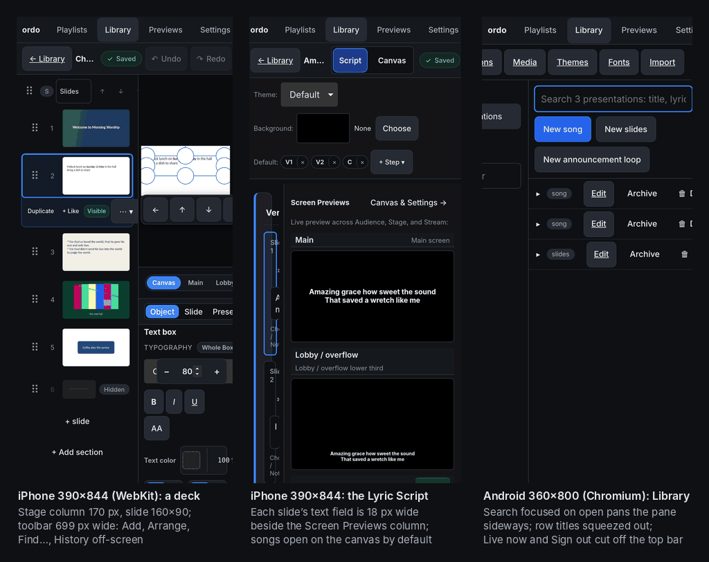
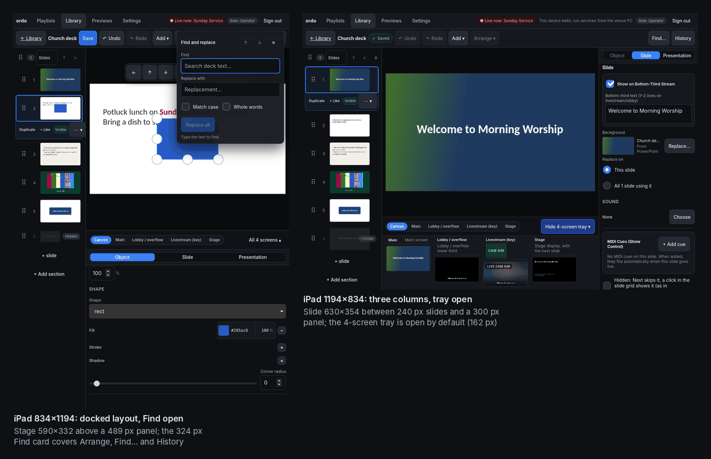
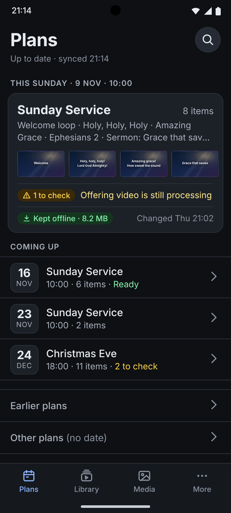
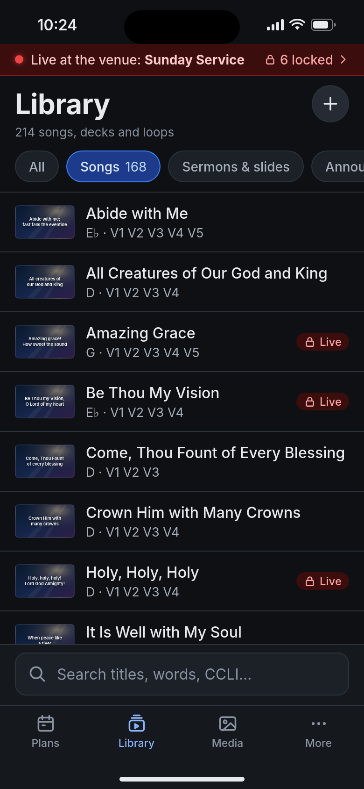
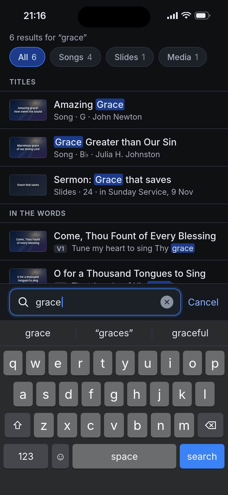
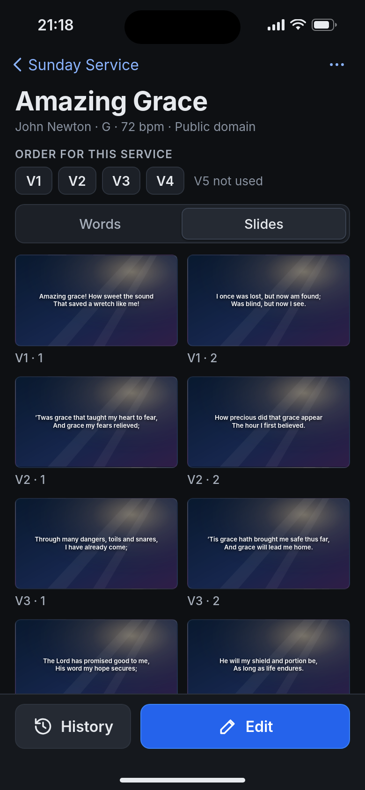
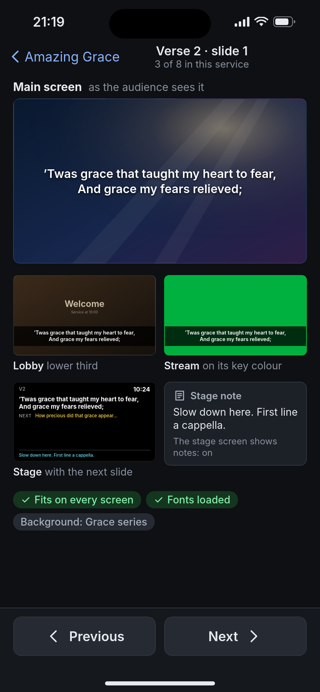
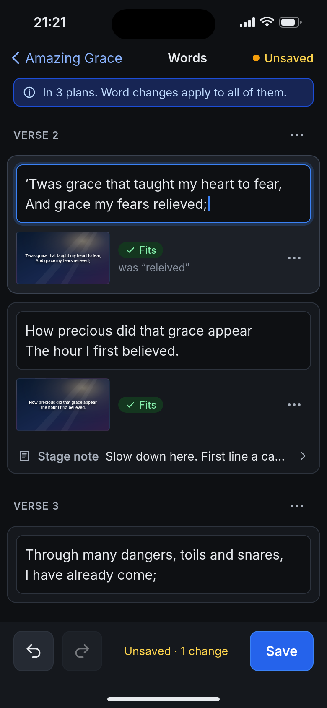
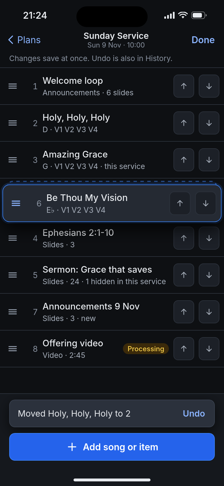
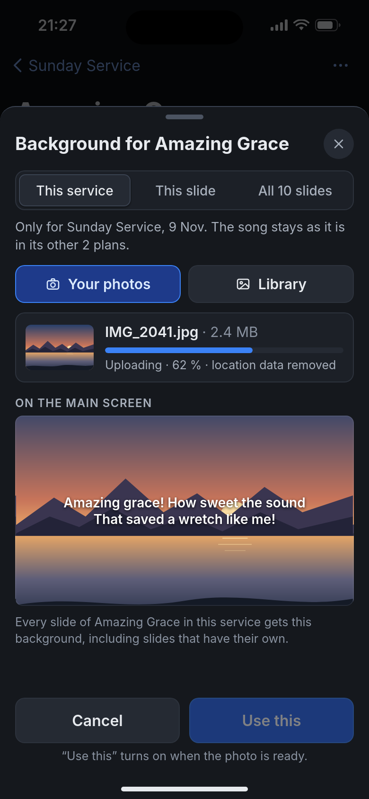

# Design 28: ordo on phones

Packages and apps involved:

- `apps/operator`: a compact layout of the edit profile, phone-first views, drafts and a phone cache.
- `apps/hub`: session caps, two small socket messages, preview renditions, playlist revisions, pacing of
  jobs and uploads while live, upload hygiene.
- `packages/domain`: per-service fields on playlist items, `updatedBy`, `Playlist.serviceTime`,
  `Media.preview`, playlist operations, plan readiness.
- `packages/protocol`: the `venue` and `library.poke` messages.
- `e2e`: phone projects in WebKit and Chromium.

Status: proposed (2026-11-07), revised against main `bd9dbcd` (2026-11-13). No code exists for it. It was
written after three competing proposals, a synthesis and a completeness review of that synthesis against the
code at `8ea4456` (§15 lists what the review changed), then revised against main after the owner's PRs #2 to
#25, the last of them #24's canvas-first editor (§16 lists what the revision changed). File and line
references are to `bd9dbcd` unless they name another commit. Mockups of the key screens are in
[28-mobile/](28-mobile/): static HTML in the operator's colours, rendered with Playwright at 390x844 (iPhone)
and 360x800 (Android), at 2x; 05, 06 and 08 were redrawn for the revision. `00-today-phones.png` and
`00-today-ipad.png` there are screenshots of main's own build (§Today).

The church's tech lead set the scope: **a phone is used outside the service**. What matters is to **view the
library** (songs, presentations, plans, media, with search and slide previews as they will look) and to
make **light changes** (fix a typo or a lyric line, reorder or add a song to a plan, change an arrangement,
hide or duplicate a slide, swap a background or picture from the camera roll, add an announcement slide
from a template, edit a stage note), safely, from home or anywhere, over the public hostname. Live control,
a phone remote, GO or Next on a phone, a confidence or stage view on a phone and an audience lyrics feed
are out of scope (§11). The Live now indicator and the lock of the live playlist's presentations stay.

**The rule volunteers can repeat: a phone can look at everything and change a little. It never changes
what is live.**

**Words.** The phone speaks the owner's words, as the venue PC does. **Audience**, **Stage** and
**Bottom-Third Stream** are what a screen is for (the role badges and add buttons of Setup's **Screens**
page, `apps/operator/src/views/settings/OutputsPage.tsx:282-286`, `:601-612`). The **Banner** is the
lower-third layer the volunteer sends during a service (`views/live/LayerBar.tsx:91-97`, F3); phones never
show or send it. **Screens** and **Setup** are venue PC pages a phone never opens. The **Lyric Script** is
the words view of a song (`views/editor/EditorView.tsx:657`; "Script" on the touch toolbar, `:553`). Looks
keep the names the church gives them: a new library has Main, Lobby / overflow, Livestream (key) and Stage
(`packages/domain/src/defaults.ts:81`, `:96`, `:117`, `:128`), and #24's Stage lens names its pills after
them (`EditorView.tsx:978-1004`). So a phone captions a preview by role, then look ("Bottom-Third Stream ·
Livestream (key)"), and repeats the Lyric Script's own tags ("⚠ 3 lines · Clips 2-line Stream",
`views/editor/SongReflowEditor.tsx:455-468`).

## Today

Measured on main's build (`bd9dbcd`, 2026-11-13) with Playwright: WebKit with the iPhone 13 descriptor at
390x844, Chromium with touch at 360x800 (`?profile=edit`, as §8's Android project), and WebKit with the iPad
Pro 11 descriptor at 834x1194 and 1194x834. Each device signed in with the operate PIN while a service was
live, then opened the Library, the Previews page, a six-slide imported deck and a song. All four have a
coarse pointer, so the editor keeps its docked layout (#24's canvas-first layout is for a fine pointer only).
The numbers replace the measurements of 2026-11-07 (8ea4456), which predate the flex shell and #24.





- **The shell.** A phone that signs in gets the edit profile (design/15 "Capability profile"), with the
  iPad's views. `.app` is a flex column that clips (`apps/operator/src/styles.css:329-334`), `.page` is the
  only scroller (`:397-403`), every route sets `app-route-<name>` (`apps/operator/src/App.tsx:162`) and the
  editor's page does not scroll (`styles.css:969-971`). The page therefore no longer grows to the nav's width
  (446 to 759 px on 2026-11-07): it keeps the screen's width and the nav is cut instead. The edit-profile
  nav (`views/Nav.tsx:76-99`) needs 767 px; at 390 and 360 px, Settings, the Live now chip (it starts at
  x 408), the role tag and Sign out are past the right edge, with nothing to scroll. On both iPads it fits.
- **Library.** A coarse pointer up to 1000 px keeps a 180 px folder column (`styles.css:1619-1621`), which
  leaves 210 px for the rows at 390 px. A row's title column is squeezed to nothing beside the kind tag,
  Edit, Archive and Delete (`views/library/PresentationsTab.tsx:288-345`), and the tab row (Presentations,
  Media, Themes, Fonts, Import, `views/library/LibraryView.tsx:7-13`) runs off the edge. The search field is
  focused on open (`PresentationsTab.tsx:241`, at least 240 px wide); in Chromium at 360 px this pans the
  library pane sideways and the folder column slides off the left edge. The document itself never scrolls
  sideways any more (`scrollX` stays 0). Themes (`#/library/themes`) opens on a phone.
- **The editor on a deck.** Touch keeps the docked layout: `showProps = coarse || drawerOpen`, and
  `canvas-first` is set only for a fine pointer (`EditorView.tsx:523`, `:527`). Up to 1000 px wide the grid
  is `220px 1fr`, with the panel in a 42 % row under the stage (`styles.css:1639-1658`). At 390 px the stage
  column is 170 px wide (140 px at 360) and the slide is drawn at the 160x90 minimum (`SlideCanvas.tsx:460-466`;
  at 360 px it is wider than its column), with handles over the whole slide. #24's Stage lens dock takes
  57 px under it and the docked panel 349 px (331 px). The touch toolbar (`EditorView.tsx:530-611`) needs
  699 px: Add, Arrange, Find… and History (and Redo at 360 px) are off-screen, and so is the lens dock's
  "All 4 screens". Reaching an off-screen control (a keyboard's focus, a test's scroll into view) scrolls the
  whole editor sideways, as the top bar did in a 1024 px window (`e2e/editor-fit.spec.ts`).
- **Songs** open on the canvas on a coarse pointer (`EditorView.tsx:549`, `:557`, `:854`), so a phone gets
  the 160x90 slide first. Switched to the Lyric Script, each slide's text field is 18 px wide: the "Screen
  Previews" column ("Live preview across Audience, Stage, and Stream") keeps its width and the script gets
  what is left.
- **Find** is a non-modal card fixed at the top right, 324 px wide (`styles.css:2733-2747`). On every touch
  size it covers the toolbar's Find… and History (x 50-374 at 390 px, 20-344 at 360, 494-818 at 834, 854-1178
  at 1194), so the toolbar cannot close it; its own ✕ and Escape can.
- **History** is #24's visual revision dialog, 760 px wide (`views/editor/RevisionsDialog.tsx:106`), inside
  the dialogs' `min-width: 380px` (`styles.css:418-428`). It fits both iPads; at 360 px it is 380 px wide and
  10 px of each side is cut off. Each selected revision is fetched whole (`:59`) and draws up to 12
  thumbnails at 320 px (`:17`, `:173`).
- **Touch targets.** 23 controls of the docked editor are under 44 px on touch, because #24's class rules come
  after the coarse 44 px rule (`styles.css:1414-1435`) and win: the selected slide card's Duplicate, + Like
  and Visible (22 px, `:2717-2721`), the lens pills (24 px, `:2586-2596`), the panel's Object, Slide and
  Presentation tabs (24 px), the section move and delete buttons (22 px), the align bar (26 px), the paint
  tabs (26 px, `:2419-2430`) and the Lyric Script's arrangement pills (22 px, `:2810-2829`). This is one of
  #24's regressions (`e2e/ipad/touch-targets.spec.ts`); §16 says which track fixes it.
- **iPad.** Portrait (834x1194): a 220 px slide list, a 614 px stage column with the slide at 590x332, the
  57 px lens dock and a 489 px docked panel below. The 4-screen tray is closed in portrait; opening it
  shrinks the canvas pane from 551 to 389 px. Landscape (1194x834): 240, 654 and 300 px columns, the slide
  at 630x354, the tray open by default (162 px, `EditorView.tsx:161`, `:482`). An iPad with a Magic Keyboard
  or a mouse reports a fine pointer with hover (`lib/capabilities.ts:56`, `:79-83`) and so gets the
  desktop's canvas-first editor, whose top bar needs about 1,250 px (`e2e/editor-fit.spec.ts`).
- **The bundle.** The operator's initial chunk is 1,713.5 kB (535.2 kB gzip; 1,713.3 and 535.1 kB at #24's
  merge, `1764e05`), and nothing in the editor is lazy (§7).
- With the operate PIN a phone gets an operate session. The edit profile never offers live control, but
  the hub accepts `live.event` from any operate socket (`apps/hub/src/ws.ts:416-418` refuses only `edit`)
  and `POST /live/events` from any operate cookie.
- "Remember this device" is ticked by default (`apps/operator/src/views/auth/LoginView.tsx:12`; ticked on
  all four devices), so a phone keeps a one-year device cookie and 12-hour sessions
  (`apps/hub/src/routes.ts:360-366`).
- Offline, the app opens the library copy with the last role from `localStorage`, with no PIN and no time
  limit (`apps/operator/src/state/session.ts:23-48`). Sign-out does not clear IndexedDB.
- PRD 01 lists a phone or tablet remote as a non-goal and, with this design, phones for the week as a
  persona (PRD 10).

## What this design does

A church's week on a phone is mostly looking things up: what is in Sunday's plan, which arrangement and
key, what a slide will look like on the big screen, whether the video is ready. The rest is small fixes
that today wait until someone is at a computer: a typo found at rehearsal, a song swapped, the photo from
Saturday's event. Planning Center already owns schedules, charts and rehearsal audio (PRD 01
"Non-goals"); what only ordo can show is the slides as the screens will show them, and what only ordo can
change is its own library.

So the phone gets the library and the plans with true previews, and a short list of light edits, each an
operation the editor already has. It runs in the operator app's edit profile with a layout made for one
thumb, under a session the hub caps so that a lost phone can neither drive a service nor delete anything.
Every change is reversible, conflicts with the venue PC and the iPad are merged or re-applied, and the
design protects the **next** service as well as the current one: a phone edit can make the next Go live
fail just as surely as a live command could break the current one, so readiness is checked and shown.

## Decisions

1. **The phone is for the week.** Library viewing and light edits. Beyond the Live now indicator, which
   names the live plan and how many presentations it locks, nothing on a phone reads or writes live state.
2. **Host: the operator app's edit profile on `op.`**, with a compact layout. No new app, hostname, origin
   or DSM rule. The editor store, operations, three-way merge, locks, revisions, thumbnail worker, look
   previews, IndexedDB library copy, search index and resumable uploads exist and run in WebKit
   (design/15 "iPad editing"). A second editor would be a second save path with its own bugs.
3. **Compact layout = not the full profile, and a small viewport**: `profile !== 'full'` and (width under
   700 CSS px or height under 500). It picks components and CSS only. The venue PC can never get it, however
   small its window, and `profileFor` is unchanged.
4. **Phone-first views over the shared stores**: four tabs (Plans, Library, Media, More), list then detail,
   bottom sheets for every dialog. A detail screen replaces the tab bar with its own action bar, so the
   thumb zone never stacks three bars.
5. **No canvas editing on a phone.** The light edits are words, stage notes, hide, duplicate, order,
   arrangement, background or picture swap and template fill: existing pure operations through the same
   editor store, one undo step each. Main opens a song on the canvas on a coarse pointer
   (`EditorView.tsx:854`); the compact layout routes songs and decks to the words editor (§2.7) and never
   mounts `SlideCanvas`, #24's floating bar or its Tune drawer.
6. **The hub caps phone sessions.** A phone signs in with `cap: 'light'` whatever PIN matched: the edit
   role minus deletes, fonts, themes and theme revisions, imports, folders, settings, show-control and
   playback fields (`Slide.midiCues`; a plan item's `keepBackground`, `audioMediaId` and `countdownTimer`)
   and every operate and live route. A `view` cap refuses every write. Capped sessions are never
   remembered. Every route declares the lowest cap it accepts and new routes refuse capped sessions until
   they say otherwise.
7. **Presentation edits save on a tap**, create a revision each time and keep the undo stack across saves.
   Drafts are written to the phone as you type.
8. **Plan edits are operations saved at once**, with Undo. On a 409 they are re-applied to the fresh plan
   by item id. Playlists get revisions and History, like presentations.
9. **"For this service" is one playlist write.** A plan item can carry its own section order
   (`sections`), slides hidden in this service (`hiddenSlides`) and a background that overrides every slide
   (`backgroundMediaId`, made a true override). One write, one lock, nothing added to the song.
10. **Song-wide changes say so.** Fixing words, hiding everywhere, duplicating a slide and a background on
    all slides change the song in every plan. The phone names how many plans use it and asks for a second
    tap when there is more than one. Typo fixes are song-wide by intent.
11. **Announcement templates are presentations tagged `template`.** "Add from template" copies a template
    slide into this service's own announcements deck, never into a shared loop without asking.
12. **Live safety stays the hub's**: the 423 lock on the live playlist and its presentations, and the copy
    frozen at goLive. The phone adds no live path. Live now is a small push with the plan's name and lock
    count, never slide text.
13. **Protect the next service.** A readiness check per plan (missing items, media not ready, fonts, text
    that does not fit, changes since the venue PC downloaded for offline use) shows on the phone and in the
    venue PC's playlist editor. Media that is not ready cannot be attached within 12 hours of a plan's
    service time. Uploads stop when the NAS's free space falls below a floor.
14. **Phones never slow a service, by a measured budget.** Capped sockets get a sequence number instead of
    the library delta, Live now is pushed rather than polled, heavy jobs and large uploads wait while live,
    writes have a byte budget, and the rehearsal gate measures the live process with phones in use.
15. **Offline reading with an expiry.** The library copy and a bounded preview cache stay readable for 14
    days after the last signed-in contact. Sign-out, a changed PIN and a revoked pass wipe them. Edits made
    offline are drafts; nothing is sent without a tap; plans are read-only offline.
16. **Previews from the shared rasterizer**, through #24's Stage lens (`SingleLookStagePreview`) at the
    tile's width, with small preview renditions and fonts loaded by family and script. Where WebKit breaks a
    line differently from the venue PC's Chrome, the preview says so.
17. **Uploads from the camera roll** go into an Inbox, with location data removed from every stored file,
    orientation applied, and the screen kept awake while they run.
18. **Credentials by phase**: PINs with caps (P0 to P2), an optional view PIN for musicians (P1), and
    passkey-backed device passes (P3, ADR 0015), issued from the iPad or the venue PC, never while live.
19. **The venue PC hears about phone edits in its playlist editor**: marks and readiness, never next to Go
    live, never modal, never taking focus.
20. **Languages and right to left from the first phone screen**, and search folds every combining mark.
21. **Reuse #24's pieces, not its layout.** The words editor reuses the Lyric Script's operations (split at
    the caret, Auto-split into 2-line slides, the stream tag, arrangement steps) once they write through
    `editText`; previews reuse the Stage lens; History reuses the visual history within byte caps. A phone
    never shows the floating bar, the Tune drawer, PaintPopover or the docked panel, and every control it
    shows is at least 44 px.

## 1. Who and why

### 1.1 People

| Person                                 | Credential (phase)                        | On the phone, outside the service                                                                                                                               | Never by accident                                           |
| -------------------------------------- | ----------------------------------------- | --------------------------------------------------------------------------------------------------------------------------------------------------------------- | ----------------------------------------------------------- |
| **Maria, worship leader**              | Edit PIN (P0-P2), edit pass (P3)          | Build and reorder Sunday's plan, add a song and pick its order for this service, fix a lyric found at rehearsal, paste a new song, swap a background for Sunday | Change a song in every plan when she meant this Sunday      |
| **Daniel, pastor**                     | Edit PIN, edit pass                       | Check that the sermon deck from his laptop looks right, fix a verse typo, hide a slide he will skip, write stage notes                                          | Lose a typed note; edit the deck during the service         |
| **Sam (keys), Jo (vocals), musicians** | View PIN (P1), view pass (P3)             | This Sunday's order, keys and arrangements, the words by section, any song in the library                                                                       | Change anything; see the pastor's notes                     |
| **Priya, tech volunteer**              | Edit PIN, edit pass                       | Check slides on every screen (Audience, Bottom-Third Stream, Stage), see whether a video is ready, fix a typo while preparing                                   | Touch Setup, Screens, looks or PINs from a phone            |
| **The tech lead**                      | Operate PIN on the PC and iPad; edit pass | Everything Priya does; issue and revoke passes from the iPad; read who changed what in History                                                                  | Give a phone the operate role, an output URL or a stage URL |
| **Ben, communications**                | Edit pass, or upload pass (P3)            | Add Saturday's picnic slide from a template with a photo from his camera roll; upload event photos to the Inbox                                                 | Browse or change the rest of the library (upload pass)      |
| **Leila, interpreter**                 | View PIN, view pass                       | Read the week's songs and sermon slides ahead of time, right-to-left paragraphs shown correctly                                                                 | n/a                                                         |
| **The volunteer at the venue PC**      | Operate PIN, venue PC only                | Sees phone changes and readiness in the playlist editor before the service                                                                                      | Be surprised by a change made at 9:55                       |
| **Congregation and visitors**          | none                                      | Not served (audience feed: §11)                                                                                                                                 | n/a                                                         |

### 1.2 The week

| When                      | What happens on phones                                                                                                                                                              |
| ------------------------- | ----------------------------------------------------------------------------------------------------------------------------------------------------------------------------------- |
| Sunday after End service  | Locks lift. A change kept during the service offers itself ("Amazing Grace can be saved now"). Large uploads that waited start. Deferred transcodes run.                            |
| Monday                    | Maria fixes the two typos the band noticed. Each save is a revision.                                                                                                                |
| Tuesday to Thursday       | Maria fills next Sunday's plan: adds songs, picks their order for this service, reorders. Musicians open the plan and rehearse from the words.                                      |
| Friday                    | Daniel uploads the sermon deck from his laptop, checks it on his phone and hides slide 12 for this service. Ben adds the picnic announcement from a template with a photo.          |
| Saturday                  | Priya checks the slides on the Bottom-Third Stream. The venue PC downloads the plan for offline use. Readiness says "Ready" or names what to fix.                                   |
| Sunday before the service | Phones can still edit the plan until it goes live. Within 60 minutes of its service time they warn first, and the venue PC's playlist editor marks what changed since its download. |
| During the service        | Phones can read everything. The live plan and its presentations are locked; other plans can still be edited. Transcodes wait and uploads over 25 MB wait.                           |

## 2. Surfaces per phase

### 2.1 Map

| Surface                                            | Route (hash)                         | Who      | Phase |
| -------------------------------------------------- | ------------------------------------ | -------- | ----- |
| Shell: Live now strip, tab bar, sheets, sign-in    | all, `#/login`                       | everyone | P0    |
| Plans (home) and Plan (read, with readiness)       | `#/playlists`, `#/plan/<id>` (new)   | everyone | P1    |
| Library with search and filters (rows open a view) | `#/library`                          | everyone | P1    |
| Song or deck: words and slide previews             | `#/view/<presentationId>` (new)      | everyone | P1    |
| Slide preview on every screen (the Stage lens)     | `#/previews/<id>/<slideId>`          | everyone | P1    |
| Media grid                                         | `#/library/media`                    | everyone | P1    |
| More: this phone, offline copy, language, sign out | `#/more` (new)                       | everyone | P1    |
| Words editor (the Lyric Script's operations)       | `#/edit/<presentationId>` (compact)  | `light`  | P2    |
| Plan editing                                       | `#/playlists/<id>` (compact)         | `light`  | P2    |
| Picture or background, camera roll upload          | sheet in a song, deck or plan        | `light`  | P2    |
| New song from text, add from template              | sheets in Library and Plan           | `light`  | P2    |
| History and conflicts                              | sheets                               | `light`  | P2    |
| Phones (passes) on the iPad and the venue PC       | `#/settings/phones` (regular layout) | operate  | P3    |

On the compact layout Setup (`#/setup`), Screens and the other settings pages (`#/settings/*`), Themes,
Fonts and Import (`#/library/themes`, `#/library/fonts`, `#/library/import`) and the live view (`#/live`)
go to the Library (P0). `allowedForRole` (`lib/route.ts:91-101`) stays the role guard: Setup (and its old
alias `#/checklist`) is for the operate role on the full profile only, and the edit profile allows only the
settings pages in `EDIT_PROFILE_SETTINGS` (`:84`); the compact layout narrows that to none. The output
services (`useLaunch`, `OutputWindows`) stay out of the compact bundle; edit sessions get no tokens anyway,
so nothing could open.

### 2.2 The shell (P0)

- **Live now strip**, pinned under the top safe area (`--safe-top`), outside anything that scrolls or clips.
  It shows only while the venue is live or its state is unknown: "Live at the venue: Sunday Service · 6
  locked", or "Live status unknown: offline". A dot, a word and a colour together. It comes from the `venue`
  push (§3.3), and never carries a cue label or slide text: today's chip shows `liveLabel`, the live cue's
  label, which is the first text of the live slide (`packages/domain/src/cues.ts:45`, `:62-65`; sent by `GET
  /live/summary`, `apps/hub/src/routes.ts:253`; shown by `views/Nav.tsx:15-34`), and that does not reach a
  phone. Nor does the strip use `health.summary`, which the hub sends only to operate sockets at hello
  (`apps/hub/src/ws.ts:404`). Tapping it opens a sheet: "A service is running at the venue. Sunday Service and
  its 6 presentations are locked until it ends. You can still look at everything and change anything else."
- **Freshness line**, under the strip when needed: "Offline · copy from Thu 21:14" or "Can't reach ordo ·
  copy from Thu 21:14".
- **Tab bar**: Plans, Library, Media, More; 56 px plus `--safe-bottom`; labels under icons; no gesture
  needed. Detail screens hide it and show their action bar (Edit, Save, Use this) in its place.
- **Sheets** for every dialog: full width from the bottom, full height under 500 px tall, primary button
  at the bottom, no fixed `min-width`. Focus moves into the sheet and returns on close; the page behind is
  `inert`; Escape and the VoiceOver escape gesture close it.
- **Back** is a button at the top left of a detail screen and also the browser's back (hash routes), so the
  iOS edge swipe works.
- **The shell is the flex column main already has.** The 2026-11-07 root fix
  (`.app { grid-template-columns: minmax(0, 1fr) }`) no longer applies: `.app` is a flex column that clips,
  `.page` is the one scroller and routes are told apart by `app-route-<name>` (§Today). The compact layout
  replaces the top nav, which needs 767 px, with the tab bar; gives every flex child of the shell and the bars
  `min-width: 0`; keeps `.page` as the only scroller, with each pane's `scrollLeft` at 0 after a field is
  focused; sizes `.app` to `100dvh` so the bars sit above Safari's toolbar; and pads the bars with
  `--safe-top` and `--safe-bottom`. Because the document never scrolls, iOS does not collapse its address bar
  when the list scrolls; detail screens hide the tab bar instead (§3.11). No autofocus on a coarse pointer
  (today `PresentationsTab.tsx:241`).
- **Touch targets**: every control of the compact layout is at least 44 px, checked by the layout test
  (§8). The docked editor's controls under 44 px on the iPad are #24's regressions, fixed in the same PR
  (§16), not by this design.
- **Sign-in**: the PIN keypad as today, no "Remember this device", the request carries `cap` (§3.2), and one
  line under it: "On a phone you can look at everything and make small changes. Services run from the venue
  PC." Locked out (429): "Too many wrong PINs from this network. Try again at 21:40. Everyone on the same
  Wi-Fi may share this wait."

### 2.3 Plans and Plan (P1)



- **Plans** lists by `serviceDate` and the new `serviceTime`, in the venue's time zone
  (`settings.general.timeZone`, `apps/hub/src/hub.ts:52-59`), not the phone's: the next plan as a card,
  then the coming ones, then earlier ones folded, then plans without a date under "Other plans". Two
  plans on one date are ordered by time, then name. (Today `nextSunday()` computes in UTC,
  `apps/operator/src/views/playlists/PlaylistsView.tsx:128-132`; P1 fixes it.)
- The card shows the items in one line, **readiness** in words ("Ready", or "1 to check: Offering video is
  still processing"), "Kept offline (8.2 MB)" and when it last changed.
- **Plan** (read): one 64 px row per item with its number, a small first-slide preview, the title and one
  secondary line: for a song its order for this service as short labels ("V1 V2 V3 V4", `arrangementLabel`
  in `lib/arrangement.ts`) and its key; for a deck its kind and slide count; for media its length and
  state ("Processing"); for a timer or an action its label. The readiness block sits at the top and lists
  each finding with the item it belongs to (§5.2). A live plan says "Live at the venue: locked until the
  service ends" and offers no Edit.
- Built from the library copy by a pure `planView(playlist, presentations, media)` and
  `planReadiness(...)` in `packages/domain`, so the phone and the venue PC agree.

### 2.4 Library and search (P1)




- Filter chips: All, Songs (`kind: song`), Sermons and slides (`slides`), Announcements (`loop`), Templates,
  Archived (the last two off by default). Folders appear as a chip row only when the library uses them.
- Rows of 64 px: a preview, the title, one secondary line (key and order, or kind and slide count).
  Presentations in the live plan carry a lock and the word "Live".
- **A row opens the view, not the editor.** On the compact layout a row opens `#/view/<id>` (§2.5); Edit
  is an action of that screen, for `light` sessions only. Today every row has an Edit link to
  `#/edit/<id>` (`PresentationsTab.tsx:328-330`), a click on the title opens an inline slide preview and a
  double-click the editor (`:288-292`), and the preview's "Open in Editor" links there too (`:386-388`). On a
  phone that row is the kind tag and three buttons with no title (§Today).
- **No Themes, Fonts or Import tab** on the compact layout (`LibraryView.tsx:7-13`). Theme saves and
  restores (`/themes/*`, `apps/hub/src/routes.ts:547-588`) and "Set as default" (a `settings.general`
  write, `ThemesTab.tsx:96`) are refused for `light` (§3.2), and a `view` session reads themes only as the
  previews need them.
- **Search sits at the bottom**, above the tab bar, where the thumb is; it is never focused on open. Results
  update per keystroke from the core worker's index, which holds titles, full lyrics, CCLI numbers, tags
  and authors (`apps/operator/src/lib/search.ts`). A match in the words shows the matching line with its
  section ("V2: 'Twas grace that taught my heart to fear"). Templates are left out unless their chip is on.
- `normalize` (`search.ts:6-13`) strips only U+0300 to U+036F, then turns every other non-letter into a
  space, so a vocalised Arabic or Hebrew word is split and an unvocalised query misses it. P1 strips
  `\p{Mn}` after NFD, before the punctuation step: one rule for every script, no range lists.
- `[+]` (P2, `light`) opens "New song from text".
- Empty results say what to try: "No songs match 'gracce'. Check the spelling, or search the words."

### 2.5 Song or deck, and slide previews (P1)




- **Words** (default for songs): section headings, then each slide's readable text (`readableText`,
  `packages/domain/src/readable.ts`), one block per paragraph with `dir="auto"`, in the order of the plan it
  was opened from (else the first arrangement). Hidden slides are marked, stage notes show under their
  slide. This is the musicians' rehearsal view and costs no rendering.
- **Slides** (default for decks): previews in two columns in portrait, three or four in landscape, labelled
  by section and number with tags in words: "Hidden in this service", "Hidden everywhere", "Video",
  "PowerPoint picture", "Doesn't fit" (the editor's overflow check, `views/editor/textFit.ts`). Previews
  draw as they scroll into view (§3.8).
- **The naming clash.** Main's slide card calls `Slide.hidden`, which hides a slide in every service,
  "Hidden"/"Visible", and its full label is "Hidden in service"/"Visible in service" (`HideSlideToggle`,
  `views/editor/SlidesPanel.tsx:471-490`). Per-service hiding (`PlaylistItem.hiddenSlides`, P2) needs
  "in this service" for itself, so before P2 ships the pill becomes "Hidden everywhere"/"Shown" on every
  layout, and the phone's two menu items read "Hide in this service" and "Hide everywhere".
- Opened from a plan, the header shows that plan's order for this service as chips; tapping a chip scrolls
  to the section.
- **Slide preview: #24's Stage lens on a phone.** A row of pills like the lens dock's (All screens, then
  one per look, `EditorView.tsx:978-1004`), 44 px tall, above the previews. Each preview is what
  `SingleLookStagePreview` draws (`views/editor/LookPreviews.tsx:127-200`) at the tile's CSS width ×
  min(devicePixelRatio, 2), at most 720 px, not the editor's 1280 px (`:146`). Captions give the role, then
  the look: Audience · Main full width; Bottom-Third Stream · Lobby / overflow; Bottom-Third Stream ·
  Livestream (key) composited over the simulated camera with its CAM SIM / RAW KEY toggle (`:56-117`; a key
  look is drawn with a transparent clear and PNG, `apps/operator/src/workers/thumb.worker.ts:176-178`, not on
  a flat key colour); and Stage with the next slide **in this plan's order** (today the lens and the tray
  follow the first arrangement; the preview job gets the plan's order) and the stage note. Previous and Next
  buttons at the bottom; a horizontal swipe as a shortcut, mirrored in right to left, which never takes over
  a pinch zoom. A video background shows its poster and "Play video (12 MB)".
- **The screens' own rules.** The jobs carry `presentationKind` (`lookPreviewJob`, `LookPreviews.tsx:29-53`),
  so the shared renderer applies the lyric-only rule as the screens do
  (`packages/renderer/src/text2d.ts:682-705`): `Slide.bottomThirdText` wins on the Bottom-Third Stream (empty
  text: nothing), a scripture slide shows its reference and text, and during a loop the lobby and the stream
  show nothing while the Stage shows "Service Starting Soon". That is the owner's choice for loops, so the
  preview says it in words: "Loops show nothing on the Bottom-Third Stream". The Stage screen lays itself out
  in `apps/stage` (the notes region, loop standby and the next item, `apps/stage/src/model.ts:176-186`,
  `:309`, `:339`); the Stage preview follows that model, not only the rasterizer's stage look. Stored looks
  keep their own settings (a library from before #16 may hide notes); the preview follows the look as stored.
- A slide set to show its PowerPoint picture (`Slide.pptx.show`) says "This slide shows a picture of the
  PowerPoint slide; text changes would not show on the screens" (design/15 "PowerPoint imports").
- `⋯` holds Add to a plan…, Copy link (a `#/view/<id>` link that works only for signed-in people) and
  Archive (`light`).

### 2.6 Media (P1; upload in P2)

- A three-column grid of preview renditions with filters Pictures, Videos, Backgrounds, From phones and, for
  editors, Inbox. A tile that is not ready says so in words: "Processing", "Waiting for the service to
  end", "Failed: tap for details".
- A tile opens a sheet: name, size, where it is used (`presentationsUsing`,
  `apps/operator/src/lib/mediaUse.ts:21`), "Use as background…" (§2.9) and, for an Inbox item, Approve
  (removes the `inbox` tag).
- Upload (P2) is the primary button at the bottom (§3.9).

### 2.7 Fixing words: the words editor (P2)



- **The Lyric Script's operations in a phone's layout.** The desktop already has a words editor for songs:
  #24's Lyric Script (`views/editor/SongReflowEditor.tsx`, "Script" on touch). A phone cannot use the
  component itself: it opens after the canvas on a coarse pointer, and at 390 px its text fields are 18 px
  wide (§Today). The phone gets its own layout over the same store and the same operations, so a phone and
  the venue PC get the same results:
  - **Split here** at the caret (Alt+Enter with a keyboard, as in the Lyric Script, `:553-557`).
  - **Auto-split (2 lines)** for a slide of more than two lines (`:120-131`, `:470-481`).
  - **The stream tag**: "✓ 2 lines", or "⚠ 4 lines · Clips 2-line Stream" (`:455-468`). It counts lines and
    measures nothing; the fit check below measures.
  - **Arrangement steps**: the section chips with × and + Step (`:285-327`). Opened from a plan they edit
    that plan's order for this service (`PlaylistItem.sections`, one playlist write, §3.5); opened from the
    Library they edit the song's default arrangement (`arrangements[0]`, as `setArrangementSections` does,
    `:34-44`) under the "Used in 3 plans" line.
- **They must write through `editText` first.** On main the Lyric Script shows each slide's `firstText`,
  which writes automatic numbers and bullets into the text (`SongReflowEditor.tsx:425`), and stores the
  field back with `{ ...o, text }` over unchanged runs and paragraph styles (`:46-55`, `:142`); #24's three
  split paths cut that labelled text and build the new slides as plain text (`:76-131`), and Split at the
  caret falls back to the text's middle, cutting a word in two (`e2e/editor-script.spec.ts`). editor-fixes (PR #23) fixes this
  in `views/editor/songScript.ts`: the field shows the lyric object's own text (`scriptText`), typing goes
  through `editText` placed by the caret (`typeScript`; an unchanged value records no undo step), every
  split cuts that raw text through the domain's slide split (`splitSlidePieces` in `views/editor/ops.ts`),
  keeping runs, numbering and bold on their letters, and a split without a caret does nothing
  (`caretPieces`). The phone's words editor (P2) is built on that, not on today's writes.
- **No canvas, floating bar or drawer.** The phone never mounts `SlideCanvas`, `FloatingContextBar` or the
  Tune drawer, and shows a small preview per slide instead (below).
- A view of the same `useEditor` store as the canvas editor (`views/editor/editorStore.ts`): `change(fn)`
  with a pure operation, `undo`, `redo` (200 steps, `editorStore.ts:94`), `save()` with the 409 merge. No
  new save path exists for phones.
- **Text**: one textarea per text box: the lyric box (`Slide.lyricObjectId`) for songs, each unlocked text
  box for decks, labelled by its first words. Typing applies `editText` (`packages/domain/src/textEdit.ts:52`),
  which keeps runs and paragraph styles. Textareas are 16 px or larger (no focus zoom) and `dir="auto"`,
  so adding an Arabic translation line under each English line works as typed. The slide menu has "Split
  here" (at the caret) and "Merge with next".
- **Show control stays put.** A slide with MIDI cues (`Slide.midiCues`, `packages/domain/src/schemas.ts:565`;
  they fire the lighting desk and the console) keeps them on its first piece when split, and cannot be
  duplicated or merged away on a phone: a copy would fire twice. Its menu says "This slide sends lighting
  cues. Change it on a computer." The hub enforces the same (§3.2). On main `cloneSlide`
  (`views/editor/ops.ts:100-121`) copies them into every copy, so Duplicate and Split lyrics repeat a slide's
  cues, and so does every Lyric Script split once it uses the domain's split; the phone's operations drop
  them from the new pieces.
- **The header says the scope**: "Used in 3 plans. Word changes apply to all of them." Fixing a typo
  everywhere is the point; the line keeps it from being a surprise.
- **Find and replace** in the header `⋯`: the existing `findReplace` (`views/editor/ops/slides.ts:184`),
  matches listed by slide before "Replace all 3".
- **Slide menu**: Hide in this service (when opened from a plan; a playlist write, §3.7), Hide everywhere
  (`hideSlide`, `ops/slides.ts:212`; second tap when the song is in more than one plan), Duplicate
  (`duplicateSlide`, `views/editor/ops.ts:123`; the same rule), Move up, Move down, Background… and Replace
  picture… (§2.9), Notes for the stage screen.
- **Stage notes**: a textarea for `Slide.notes`, with a read-only line saying whether the Stage look shows
  notes (`PropsRule.notes`, design/16 "Notes region"; on by default in new libraries since #16, a stored
  look keeps its own); looks are settings and stay off the phone.
- **What the Bottom-Third Stream shows** (decks, optional): a one-line field for `Slide.bottomThirdText`
  (`schemas.ts:538`), the editor's "Show on Bottom-Third Stream" (`views/editor/SlidePanel.tsx:112`), with
  its preview.
- **Fit**: about 150 ms after the last keystroke the slide's small preview redraws in the thumbnail worker,
  and the overflow check marks a box whose text no longer fits: "This line will be cut on the screen.
  Shorten it, or fix the box on a computer."
- **Save bar**: Undo and Redo (typing in one field coalesces into one step, as the editor does), the state
  in words ("Unsaved · 1 change", "Saving…", "Saved · revision 14", "Not saved: no connection. Your change
  is kept on this phone."), and Save. After a save the undo stack stays, so Undo is one more save, as a new
  revision.
- **Drafts** are written to the phone 1 s after each change and on `pagehide` and `visibilitychange`
  (§3.6), because iOS and Android can discard a background tab without any event. Leaving with unsaved
  changes asks "Save / Keep as draft / Discard".
- **Read-only cases**: a slide that is a picture of a PowerPoint slide ("Edit it on a computer"), a deck
  above the presentation size budget (`packages/domain/src/size.ts:24`): "This deck is too large to edit on
  a phone (6.1 MB). Its words can still be read."

### 2.8 Plan editing (P2)



- Reorder with the existing pointer `Sortable` (grip, 300 ms hold, auto-scroll; a cancelled touch puts it
  back; design/15 "Touch") and with move buttons on each row, so VoiceOver, TalkBack and Switch Control
  users reorder without dragging.
- **Add** opens a sheet with library search, songs first, templates left out; choosing a song asks for its
  order for this service (a saved arrangement, or pick sections) and adds it after the selected row.
- **Row menu**: Order for this service…, Hide slides in this service…, Background for this service…
  (§2.9), Remove (with Undo). Transitions, media playback fields and the item's service settings stay on a
  computer: music for the item (`audioMediaId`), its countdown (`countdownTimer`) and "Continue previous
  background" (`keepBackground`, `views/playlists/ItemSettings.tsx:136-142`). The phone shows them as words
  ("Music: Prelude · countdown to 10:00") and the hub refuses changes to them from a capped session (§3.2).
- **Copy plan for a new date** (in the plan's `⋯`): a new plan with the same items and the next service
  date.
- Every change is one operation saved at once (§3.7), shown in an Undo bar for 10 s and kept in History, so
  the 10 s are never the only chance.
- A live plan is read-only. Within 60 minutes of its service time (§3.12) the first change asks once: "This
  service starts at 10:00. The volunteer may already have checked these slides. Change anyway?"

### 2.9 Picture or background from the library or the camera roll (P2)



- Three scopes, with **This service** as the default: `PlaylistItem.backgroundMediaId`, now a true
  override (§3.5), a playlist write. **This slide** and **All N slides** run `replaceBackground`
  (`ops/slides.ts:361`) with the scope the editor offers, as presentation edits with the "used in N plans"
  line. A picture of another aspect is re-cropped, never stretched.
- **From your photos** opens the native picker (§3.9). The sheet shows the upload, then the preview under the
  Audience screen's look with the photo in place, and enables **Use this** only when the picture is ready
  (images take seconds). Within 12 hours of the plan's service time, a medium that is not ready cannot be
  attached at all (§5.2).
- **Replace picture** on a slide with one picture (an announcement photo) uses `replacePicture`
  (`ops/pictures.ts`), which keeps the box, mask, flips and crop look.

### 2.10 New song from text, add from template (P2)

- **New song from text**: a large textarea for pasted lyrics (SongSelect's copied text, ChordPro, or plain
  text with `[Verse 1]` labels), parsed by `parseLyrics` (`packages/domain/src/lyrics.ts:161`) and shown as
  sections before saving; title, author, CCLI number, key, theme; then "Add to Sunday Service?". Chord lines
  are kept in `Section.chords` as today and not shown.
- **Add from template**: the template slides (slides of presentations tagged `template`) in a strip; one
  field per text box, labelled by the template's own text ("Title", "Date and place"); "Choose photo" for
  its single picture; a preview on the Audience screen with the fit check per field ("12 characters too long
  for this template").
  - The target defaults to **this service's own announcements deck**: the plan's announcements item when no
    other plan uses it, else a new deck "Announcements · 9 Nov" added to the plan. A shared loop is offered
    second, with "Welcome loop is in 5 plans. Add there for every service?".
  - "Add slide" copies the template slide with `cloneSlide` (fresh ids, `views/editor/ops.ts:100`), applies
    `editText` per field and `replacePicture`, and saves one revision.
  - No templates yet: "Your church has no announcement templates. A designer makes them on a computer: any
    presentation tagged 'template'."

### 2.11 History and conflicts (P2)

- **History** (song, deck or plan): revisions newest first with the time and who saved them ("Thu 21:14 ·
  a phone with the edit PIN", or in P3 "Thu 21:14 · Maria's phone"), what changed (slides changed, items
  moved), and **Restore**, which creates a new revision and loses nothing (`POST
  /presentations/:id/restore/:rev`, `apps/hub/src/routes.ts:471-478`).
  - **A phone lists revisions without their bodies.** #24's visual history (`RevisionsDialog.tsx`) is the
    desktop's: it fetches each selected revision whole (`GET /presentations/:id/revisions/:rev`, `:59`,
    and again whenever the open draft changes, `:80`) and draws up to 12 thumbnails at 320 px (`:17`,
    `:173`), and the list route parses every stored revision to read its title
    (`apps/hub/src/library.ts:403-415`), up to 4 MiB each. On a phone the list comes from a per-revision
    summary the hub stores at save (§3.4), and a revision's slides are drawn only when the person taps
    Preview: one revision at a time, the first six slides at tile width, within the caps of §3.4. Restore
    needs no body on the phone.
  - Restoring a plan revision that names a deleted presentation leaves that item out and says so ("2 items
    were not restored: their presentations were deleted"). An order for this service that names a deleted
    section drops that section.
- **Conflict sheet** (a 409 the three-way merge `mergeThreeWay`, `views/editor/merge.ts:70`, could not
  combine fully): the overlaps by slide, "Keep theirs", "Keep mine" and **Copy my text**, so a typed line is
  never lost even when the person keeps theirs. Cancel has the focus. It is `ConflictDialog`'s content laid
  out for a phone.

### 2.12 States, screen by screen

| State                                  | What the phone shows                                                                                                                                |
| -------------------------------------- | --------------------------------------------------------------------------------------------------------------------------------------------------- |
| First sign-in                          | "Getting the library (1.4 MB)…" with progress; Plans fills first. Later starts paint from the IndexedDB copy at once.                               |
| Empty                                  | Plans: "No plans yet. Plans are made on a computer or iPad." Library: "No songs yet." Media: "No pictures yet."                                     |
| Offline                                | "Offline · copy from Thu 21:14". Previews for kept items, words for all. Edits become drafts; plans are read-only.                                  |
| Copy expired (14 days without contact) | "This phone has not reached ordo for 14 days. Sign in to see the library again." The copy stays until sign-in or sign-out.                          |
| Session ended, online                  | The copy stays readable with "Sign in to refresh"; Save opens the sign-in sheet over the editor and continues after it.                             |
| Signed out because a PIN changed       | "The edit PIN was changed, so this phone was signed out and its copy removed. Sign in with the new PIN."                                            |
| Locked out (429)                       | The time left, and that everyone on the same Wi-Fi may share it.                                                                                    |
| Locked during the service              | "Live at the venue: locked until the service ends." Save becomes "Keep my change for after the service" (a draft), offered again after End service. |
| Saved during a goLive                  | When the save landed after goLive fetched the plan: "Saved. The running service uses the version from 9:58." (`apps/hub/src/live.ts:356-370`)       |
| Processing (media)                     | "Processing · usually under a minute" for pictures; "Waiting for the service to end" for videos while live.                                         |
| Upload interrupted                     | "Paused: keep ordo open to finish (3 of 5)". It resumes from the hub's offset when the page is back.                                                |
| Phone storage full                     | "This phone is out of space for ordo. Offline previews are off; your drafts are kept." (`QuotaExceededError` empties the preview cache first.)      |
| NAS disk nearly full                   | Upload refused: "The church's storage is nearly full. Ask the tech lead." (507)                                                                     |
| Too large or picture-only              | Read-only with the reason (§2.7).                                                                                                                   |
| Error                                  | In words with one action: "Could not save: the library is restarting. Try again." (the proxy's 503, design/12 "Routing"); the draft is kept.        |
| Permission                             | A `view` session has no Edit buttons; a refused write says "This phone can look but not change."                                                    |
| App updated                            | The version guard reloads (design/13 "Versioning"); drafts survive in IndexedDB.                                                                    |
| Pass revoked (P3)                      | "This phone was signed out by the church. Its copy of the library was removed."                                                                     |

## 3. Architecture

### 3.1 Where it runs

- **App**: `apps/operator`, edit profile, on `op.<venue>.synology.me`, as on the iPad. The core worker joins
  the hub as an editor (design/15 "The edit profile"): no `LiveCore`, no service cache, no fallback
  authority, every dispatch a no-op.
- **Layout class**: `compact | regular`, `compact` when `profile !== 'full'` and
  `matchMedia('(max-width: 699px), (max-height: 499px)')` matches. It is on `window.__ordo` beside the
  profile for tests. An iPhone in landscape (844x390) stays compact; an iPad in a narrow Split View gets
  the compact views (with its own, uncapped session).
- **Forced profile guard**: `?profile=full` or `ordo.profile` is ignored on a device with neither Window
  Management nor WebHID (it would give a broken operator there). The hub's cap, not this guard, is what
  protects a phone's cookie.
- **Routes**: the existing ones (`#/library`, `#/library/media`, `#/edit/<id>`, `#/playlists[/<id>]`,
  `#/previews/<id>/<slide>`) render compact views on the compact layout; `#/plan/<id>`, `#/view/<id>` and
  `#/more` are new and allowed for every role in `allowedForRole` (`lib/route.ts:91-101`). On the compact
  layout Setup, settings, Themes, Fonts, Import and Live go to the library (§2.1).
- **Code split**: the compact path must not download the canvas editor. On main nothing in it is lazy: the
  initial chunk holds `src/views/editor` (257.5 kB), konva, react-konva and react-reconciler (338.5 kB) and
  the renderer's preset geometry (162.6 kB) (§7). The lazy editor chunk takes `EditorView` with what #24
  added: `FloatingContextBar`, `UnifiedTypography`, the Tune drawer (`ObjectPanel`, `SlidePanel`,
  `PresentationPanel`), `ColorPicker`'s `PaintPopover` and the Stage lens dock, where the 2026-11-07 text
  said "the format bar and panels". `LookPreviews` and `SingleLookStagePreview` move out of
  `views/editor` into a module the phone's previews import without the editor. The first edge to cut is
  `components/deckSwatches.ts:4`, which imports the editor store into a shared component (every colour
  field reaches it through `ColorPicker`); editor-ux (PR #23) hands the deck to the pickers through a React
  context instead. Settings and Setup are already lazy routes in PR #23 (a1-prep), whose
  `tools/bundle-report.mjs` and CI budget (design/24 "Bundle budget", `24-repo-conventions.md`) will also guard the compact path.

### 3.2 Sessions, caps and credentials

Every session gets a **cap**, stored on its row in `ordo.db` and checked by both processes:

| Cap     | Who                                                 | Can                                                                                                                          |
| ------- | --------------------------------------------------- | ---------------------------------------------------------------------------------------------------------------------------- |
| `full`  | Sessions as today: the venue PC, the iPad, a laptop | Its role (operate or edit), unchanged                                                                                        |
| `light` | A phone, whatever PIN matched (edit or operate)     | Read everything an edit session reads; write presentations, playlists, uploads, media names and tags, restores. Nothing else |
| `view`  | The view PIN (P1), a view pass (P3)                 | Read, with deck notes, Inbox media, source documents and stored client scenes left out. No writes                            |

- **How a phone gets `light`**: the sign-in on an edit-profile device whose shorter **screen** side (from
  `screen.width` and `screen.height`, not the viewport) is under 600 CSS px sends `cap: 'light'`. The
  viewport would leak: Safari's "Request Desktop Website" gives a 980 px layout viewport (verify that
  `screen` stays at the device size there), and unfolded foldables and tablets are wide. An unfolded
  foldable is a tablet and gets what an iPad gets. The cap protects the phone's cookie, not the PIN: anyone
  who knows the operate PIN can still use it at a computer.
- **Refused for `light`**, at the route: every `DELETE`; `/fonts/*`; `/themes/*`, theme revisions and
  their restore included (`apps/hub/src/routes.ts:547-588`); `/import/*` and re-import or make-editable;
  folders; settings writes (Themes' "Set as default" writes `settings.general`); PINs and passes; outputs
  and tokens; backups; media playback fields (loop, gain, audio pair); every operate and live route. Every
  route declares the lowest cap it accepts beside its role (design/21 "Authorisation"); the startup check
  fails a route without one, and the default refuses capped sessions, so a new route is closed to phones
  until it says otherwise.
- **Refused for `light`, per field**: `Slide.midiCues` (show control: MIDI notes to the lighting desk and
  the console, `schemas.ts:565`), and a plan item's `keepBackground`, `audioMediaId` and `countdownTimer`
  (`schemas.ts:773-775`). Presentation and playlist saves are whole-document PUTs (`routes.ts:444-455`,
  `:530-538`), so the hub compares a capped session's body with the stored document, per slide id and per
  item id, and answers 403 `cap` (with the field's name) when one of these differs: a new slide or item may
  not carry them, a slide that has MIDI cues may not be removed, and a kept one keeps them unchanged.
- **Plates**: a phone never bakes the decoration plates of M9 (design/27; decisions: never on phones or
  compact layouts, never while live except the go-live bake). A phone's save may leave a plate stale; the
  venue PC re-bakes it after its own save or at Go live, and readiness lists it (§5.2).
- **Never remembered**: a capped sign-in ignores and clears the `ordo_device` cookie (today
  `remembered = remember || deviceOk`, `routes.ts:360-366`), so it is a 1-hour sliding session (PRD 09).
- **Role**: a capped session's role is `edit` whatever PIN matched, so everything the hub already refuses
  to the edit role stays refused: `live.event` at the socket (`ws.ts:416`), every operate route, live
  state. The cap only narrows it further.
- **View PIN (P1, optional)**: Settings → PINs gains "View PIN (optional, for musicians)", empty by default
  (off). Its sessions are always `view`. It shares the PIN rate buckets.
- **Revocation before passes**: changing the edit or view PIN ends those sessions (`apps/hub/src/auth.ts:88-97`).
  The hub's 401 then carries `reason: 'pin-changed'`, on which a phone wipes its copy. It also signs out
  the worship leader's iPad; the volunteer guidance says so.
- **Passes (P3, ADR 0015)**: a per-device credential with a label ("Maria's phone"), a preset (`view`,
  `light`, or `upload`: Inbox uploads and its own uploads only) and a lifetime (90 days unused, one year at
  most). No accounts: ADR 0010 holds.
  - Stored in a `passes` table in `ordo.db` (id, label, cap, passkey credential id and public key, created
    by, created, last seen, last network class, expires, revoked). The names `ordo_device` and `devices`
    are taken by the remembered-device cookie and table (`routes.ts:57`, `apps/hub/src/db.ts:51`), which
    stay for the venue PC.
  - **Issued** in Settings → Phones from an operate session on the iPad or the venue PC, refused while a
    service is live. It shows a QR code and an 8-character code for 2 minutes, or makes a single-use invite
    link valid 24 hours. The code is 128 bits in the URL fragment (not in DSM logs or `Referer`).
  - **Claimed** with a **passkey**: the phone registers a WebAuthn platform credential with user
    verification (Face ID, fingerprint or the phone's code) for the pass. Afterwards "Unlock" is one tap and
    a biometric: no PIN typed on the public hostname, a short session, and the passkey is shared between
    Safari and the home-screen app through the phone's keychain (verify on iOS and Android), which removes the
    two-cookie-jars problem. A phone without passkeys gets an `ordo_pass` cookie (`HttpOnly; Secure;
    SameSite=Strict`, host-only) instead. The hub needs a WebAuthn verifier: a new dependency under
    design/21 "Dependencies".
  - **Claim limits**: 10 failures per IP per 15 minutes. No hub-wide claim bucket: 128-bit codes cannot be
    guessed, and a hub-wide bucket would let anyone block real claims.
  - **Revoked** from Settings → Phones ("Revoke", "Revoke all phones"): its sockets close at once (as
    `disconnectOutput` does), its next request gets `401 revoked`, and the phone wipes its copy. Passes
    survive PIN changes.
  - Pass writes record the label in `updatedBy` and in revisions; creation, claim and revocation are logged
    with the label and network class, never a code.

### 3.3 Protocol: what reaches a phone

A capped socket receives `welcome`, `venue`, `library.poke` and `bye`; it may send `hello` and
`time.ping`. It never receives live state, `library.delta`, tokens or settings with tokens. Nor does it
get `health.summary`, which the hub sends to operate sockets only, at hello (`apps/hub/src/ws.ts:404`): the
phone's Live now strip comes from `venue`, and readiness from the library copy. `window.__ordo.ui` and
`setUi` exist in every operator build, the compact shell included; they read and set UI state only, and
the `light` review lists them.

```ts
// packages/protocol, hub → editor sockets (Zod schemas, design/24)
type Venue = {
  t: 'venue';
  v: 1;
  mode: 'idle' | 'live';
  playlistId?: Id;
  playlistName?: string;
  since?: string; // no cue, no slide text
  lockedPresentationIds: Id[];
};
type LibraryPoke = { t: 'library.poke'; v: 1; seq: number }; // capped sockets, instead of library.delta
```

- `venue` is sent after `welcome` and on goLive, End service and lock changes, built once and written to
  every editor socket. It replaces the 8 s `/live/summary` poll on phones; the poll remains only while the
  socket is down and the page is visible. The iPad's chip keeps using `/live/summary` as design/15 says.
- `library.poke` carries only the library sequence. The phone's core then fetches
  `GET /library/snapshot?since=<seq>` (`routes.ts:420-431`), debounced 2 s and only while visible. That
  request is answered by the library process (redacted for `view`) and only streamed through the live
  process, so a 4 MiB deck saved during a service costs the live process one small string per phone
  instead of 4 MiB per phone.
- Both are new message types: one `APP_VERSION` bump in P1 (design/13 "Versioning").

### 3.4 Hub changes per phase

| Phase | Change                                                                                                                                                    | Process | Why                                                                                                                           |
| ----- | --------------------------------------------------------------------------------------------------------------------------------------------------------- | ------- | ----------------------------------------------------------------------------------------------------------------------------- |
| P0    | Session `cap` (`full`, `light`, `view`); `POST /auth/pin { pin, cap }`; every route declares its lowest cap; capped sign-ins clear the device cookie      | both    | §3.2: a phone cookie can neither drive a service nor delete                                                                   |
| P0    | `Origin` check and an `X-Ordo` header on every non-GET API request                                                                                        | both    | Writes rely on `SameSite=Lax` alone today; the hub checks `Origin` only on socket upgrades (`ws.ts:169-185`)                  |
| P0    | Private (LAN) addresses leave the global PIN bucket (50 per 15 minutes, `auth.ts`); the per-IP bucket stays                                               | both    | A scanner on the public name must not lock out the venue PC                                                                   |
| P0    | `DELETE /fonts/:id` answers 423 for fonts the live copy uses, like `DELETE /media/:id` (`routes.ts:669-671`)                                              | library | Today a font can be removed under a running service (`routes.ts:781-784`)                                                     |
| P0    | `affectsContext` (`apps/hub/src/librarylink.ts:66-68`) counts a media change only for the logo and the looks' holding images                              | live    | Today every media change, when no logo is set, makes every output refetch its config (`apps/output/src/link-core.ts:434-437`) |
| P0    | While live: heavy jobs (video, GIF) wait until End service plus 2 minutes; light jobs run under `nice 19` with one thread                                 | library | Today uploads and ffmpeg run at full priority during a service                                                                |
| P0    | `broadcastLibrary` builds the `stripped` string only when a batch has a settings change                                                                   | live    | It stringifies every delta twice (`ws.ts:519-541`)                                                                            |
| P1    | `venue` and `library.poke` (§3.3); at most 80 capped sockets in total                                                                                     | live    | No per-phone serialisation, no per-phone polling                                                                              |
| P1    | `view` cap and the optional view PIN; `view` redaction in snapshots and `?since=`: no `Slide.notes` on decks and loops, no Inbox media                    | library | Musicians read without the edit PIN                                                                                           |
| P1    | `GET /files/:hash` for `view` principals limited to delivery files, preview renditions, posters and fonts; never source documents or stored client scenes | both    | Any principal can fetch any hash (`routes.ts:951-961`): a stored `.pptx` or client scene (`:878-886`) holds speaker notes     |
| P1    | `Media.preview` renditions and their backfill, which runs only while no service is live                                                                   | library | §3.8                                                                                                                          |
| P1    | gzip (level 6) for JSON answers over 32 KB, cached per library sequence in the library process                                                            | library | The snapshot shrinks five to ten times; gzip rather than Brotli to spare the NAS CPU                                          |
| P1    | `Playlist.serviceTime`; dates in the venue's time zone                                                                                                    | domain  | §2.3, §5.2                                                                                                                    |
| P1    | Public `GET /health` answers `{ ok, version }`; mode and sequence for authenticated callers only (check its consumers first)                              | live    | Today it tells anyone whether a service is running (`routes.ts:324-331`)                                                      |
| P2    | Playlist revisions: `playlist_revisions`, `GET /playlists/:id/revisions[/:rev]`, `POST /playlists/:id/restore/:rev` (423 while live)                      | library | Today a playlist has a `rev` and a 409 but no history                                                                         |
| P2    | Revision retention for both kinds: newest 50 or 30 days, whichever is more, but at most 200 revisions and 64 MiB per presentation or plan                 | library | Today's prune has no cap (`apps/hub/src/library.ts:392-401`), and phone saves add revisions                                   |
| P2    | Revision summaries (`title`, `slides`, `changed`) kept at save, listed without bodies; capped: 200 rows, 20 bodies (≤ 4 MiB) per 10 min                   | library | The list parses every revision to read its title (`library.ts:403-415`); History fetches whole revisions (§2.11)              |
| P2    | `updatedBy` on presentations and playlists; the per-service item fields; the background override (§3.5)                                                   | domain  | §3.5                                                                                                                          |
| P2    | Write budget per session: 60 writes a minute (burst 20) and, while live, 8 MiB of request bodies a minute; uploads: 50 files and 4 GiB a day              | library | A stolen session cannot flood the NAS or the live process                                                                     |
| P2    | Request bodies may be `Content-Encoding: gzip` (decompressed size capped at the presentation budget)                                                      | library | A save sends the whole presentation, up to 4 MiB (`routes.ts:444-455`)                                                        |
| P2    | Image ingest removes location and device metadata from the stored original and the delivery file, applies orientation before reading dimensions; backfill | library | Images up to 3840 px are served as uploaded (`apps/hub/src/media/service.ts:381-395`), GPS included                           |
| P2    | Free-space floor: uploads and backfills stop when the data volume has less than max(5 GiB, 5 %) free (`fs.statfs`), with 507 and a health line            | library | No free-space check exists; the same volume holds `live.db`, `ordo.db` and the backups                                        |
| P2    | Job priority for media the next plan uses; the `inbox` tag on uploads from capped sessions                                                                | library | §5.2, §4                                                                                                                      |
| P3    | Passes: table, principal, `/passes` routes, WebAuthn registration and assertion, claim limits, 3 sockets per pass, revocation closes sockets              | both    | §3.2; ADR 0015                                                                                                                |

### 3.5 Domain changes

| Change                                                                           | Where                                | Meaning                                                                                                                                                                                                                                                                                                                                              |
| -------------------------------------------------------------------------------- | ------------------------------------ | ---------------------------------------------------------------------------------------------------------------------------------------------------------------------------------------------------------------------------------------------------------------------------------------------------------------------------------------------------- |
| `PlaylistItem.sections?: Id[]` (at most 500)                                     | `schemas.ts:765-788`, `cues.ts`      | The section order for this service. When set it wins over `arrangementId`; ids the presentation no longer has are skipped. One playlist write instead of a new presentation arrangement plus a playlist write, which are not atomic and pile up                                                                                                      |
| `PlaylistItem.hiddenSlides?: Id[]`                                               | same                                 | Slides hidden in this service. Their cues are marked `hidden`, exactly as `Slide.hidden` is: sequential navigation skips them, a click on one still shows it (design/27 §9)                                                                                                                                                                          |
| `PlaylistItem.backgroundMediaId` becomes a true override                         | `cues.ts:46`                         | Today a slide's own background wins (`slideBackground(slide) ?? item.backgroundMediaId ?? p.backgroundMediaId`), so for ProPresenter imports, which set one per slide (`packages/importers/src/pro7.ts:1488`), the venue PC's "Background override" (`ItemSettings.tsx:129-135`) does nothing. The order becomes item, then slide, then presentation |
| `updatedBy?: { kind: 'operate' \| 'edit' \| 'light' \| 'pass'; label?: string }` | `Presentation`, `Playlist`           | Who made the last change, for the venue PC's marks. Today `savedBy` is `role@ip` in the revisions table only (`library.ts:372-415`), and playlists record nothing                                                                                                                                                                                    |
| `Playlist.serviceTime?: string` (`HH:MM`)                                        | `Playlist`                           | With `serviceDate`, in the venue's time zone: ordering, readiness windows, the warning                                                                                                                                                                                                                                                               |
| `Media.preview?: { hash, width, height }`                                        | `Media`                              | A JPEG at most 640 px wide (PNG with alpha) for drawings under 960 px                                                                                                                                                                                                                                                                                |
| `template` and `inbox` tags                                                      | `Presentation.meta.tags`, media tags | Conventions, no schema change                                                                                                                                                                                                                                                                                                                        |
| `planView`, `planReadiness`, `applyPlaylistOps`                                  | `packages/domain`                    | Pure functions shared by the phone and the venue PC                                                                                                                                                                                                                                                                                                  |

All fields are optional and additive (design/27 §3.2). The cue changes go with renderer and cue goldens and
one `APP_VERSION` bump (to the next version, with the shared-source digest re-recorded, design/13
"Versioning"). The override changes how existing plans look at their next Go live where an item background
sits over a song with per-slide backgrounds; before the first service there are few such plans, and the venue
PC's playlist editor marks them once ("Background for this service now covers every slide").

Since 2026-11-07 a plan item already has `keepBackground`, `audioMediaId` and `countdownTimer`
(`schemas.ts:773-775`), all refused to capped sessions (§3.2), and PR #23 brings two things this table
builds on:

- **Item-entry effects on whichever cue enters an item** (live-safety, 377bd90). On main the clear when an
  item has no background and the item's countdown sit on the item's first cue (`cues.ts:47-49`, `:80-82`),
  so hiding that slide (`Slide.hidden` today, `hiddenSlides` in P2) loses them. The fix marks every cue of
  the item (`clearOnEntry`) and applies them when a GO enters the item. `hiddenSlides` ships after it.
- **ProPresenter backdrops** (pro7-effects). #20's importer draws a presentation's or a slide's colour as
  an opaque full-slide shape at the bottom of the slide's objects, above any background; pro7-effects marks
  it as the slide's backdrop (`origin.role: 'bg'`), the editor's background replace removes it, and cues
  whose background is the item's override draw without it (`Cue.backgroundOverride`). The true override
  above changes the order on top of that; the §8 flow uses a ProPresenter song with such backdrops.

### 3.6 Presentation edits and drafts

- Edits go through `useEditor` (§2.7). A save sends the whole presentation, gzip-compressed with
  `CompressionStream` when larger than 32 KB.
- **Drafts** live in an IndexedDB `drafts` store: `{ presentationId, baseRev, draft, savedAt }`, written 1 s
  after each change and on `pagehide` and `visibilitychange` to hidden. At most 20 drafts of up to 4 MiB;
  after 30 days a draft is offered once more, then dropped. Opening the presentation again offers the draft
  ("You have an unsaved change from Thu 21:14").
- A save whose answer was lost and is tapped again gets a 409 whose "theirs" is the phone's own save; the
  three-way merge then has nothing to combine and nothing to save.
- A 423 keeps the change as a draft marked "after the service"; when the `venue` push says idle, the phone
  offers it, merged with any newer version.

### 3.7 Playlist operations and rebase

```ts
type PlaylistOp =
  | { k: 'move'; itemId: Id; after: Id | null } // null = to the top
  | { k: 'add'; item: PlaylistItem; after: Id | null } // item.id made on the phone
  | { k: 'remove'; itemId: Id }
  | { k: 'arrangement'; itemId: Id; arrangementId?: Id; sections?: Id[] }
  | { k: 'hide'; itemId: Id; hiddenSlides: Id[] }
  | { k: 'background'; itemId: Id; mediaId?: Id };
```

- Each operation is applied to the phone's copy at once and saved with `PUT /playlists/:id` and the `rev` it
  was made on.
- **On 409** the phone fetches the plan, re-applies its unsaved operations in order by item id, and saves
  again, at most twice before it shows the conflict. A `move` after an item that is gone goes to the end,
  with a note; an operation on an item that is gone is dropped with a note ("Amazing Grace was removed on
  another device; your order change was not kept").
- **Idempotent by item id**: an `add` whose item id exists is skipped, so a save whose answer was lost never
  adds the song twice.
- **On 423** (the plan went live) nothing is saved; the phone lists what was not saved and offers "Apply
  again after the service" from History.
- `applyPlaylistOps` is pure, with property tests (re-applying is idempotent, item ids stay unique). The
  regular layout's `PlaylistEditor` uses it too, so the iPad and the venue PC stop dropping a change on a
  409 (`views/playlists/PlaylistEditor.tsx:69-84` today says "Reloaded the latest version; redo your last
  change").

### 3.8 Previews as they will look

- **Drawing**: the thumbnail worker draws each slide with the shared rasterizer under a look, as the
  Previews page, #24's Stage lens and its 4-screen tray do (`apps/operator/src/workers/thumb.worker.ts:138-179`,
  design/15 "Look previews"); the worker is its own 395 kB chunk, loaded with the first preview. Tiles draw
  at their CSS width × min(devicePixelRatio, 2); a drawn tile is cached as a blob keyed by the slide, the
  look, the renditions it uses and the font generation, so scrolling back is instant and a change redraws
  only what changed.
- **Preview renditions**: every image gets `Media.preview`, made by the delivery downscale (`downscaleImage`,
  `apps/hub/src/media/service.ts:381-395`) as a light job; videos use their 640x360 poster
  (`apps/hub/src/media/ffmpeg.ts:237-238`). Imported page pictures are media and get one too. A 3840 px
  background of 1 to 3 MB becomes about 60 KB. The worker uses `preview` under 960 px and the delivery file
  above.
- **Fonts**: on the compact layout `syncFonts` (`services/fonts.ts:25-46`, which today loads every library
  font) registers every face but loads one only when a slide on screen uses its family
  (`referencedFontFamilies`, `packages/domain/src/resolve.ts:154`) or needs it for its script
  (`textScripts`, `readable.ts:75`: Arabic, Hebrew, Devanagari and CJK faces by script, not only by family).
  A preview drawn before its font arrived is redrawn when the resolver's generation changes (design/27 §10).
- **Honesty**: a preview drawn without a font it needs, or without its rendition yet, says "Preview may
  differ: Montserrat not loaded yet".
- **WebKit text**: the text engine measures with canvas `measureText`, probed in Chromium
  (`packages/renderer/src/text/measure.ts:4-22`). WebKit may measure, space letters or apply `lang`
  differently, so an iPhone could break a line where the venue PC does not. P1 adds a test that compares
  the line-break positions of every paragraph in WebKit and Chromium over the fixture library (and, at the
  gate, the church's library). Where they differ, previews on WebKit carry "Line breaks on this phone may
  differ from the screens", and the fix is to measure from the font's own advance widths (the sfnt reader
  in `packages/pptx-scene/src/metrics.ts` that table layout uses, which M9 moves to
  `packages/renderer/src/text/sfnt/reader.ts`; verify it covers shaping well enough). The PowerPoint
  converter measures with those metrics, so a deck parsed in WebKit equals one parsed in Chromium, but only
  when faces are given; a phone never parses a deck (`light` refuses `/import/*`). The claim "as they will
  look" is made only where the test holds.
- **WebKit effects**: a ProPresenter picture's soft edge is blurred with `ctx.filter` on main
  (`packages/renderer/src/text2d.ts:446-487`), which Safari lacks, so phones and iPads draw a hard inset
  rectangle where the screens draw a feather. pro7-effects (PR #23) draws picture shadows and soft edges as
  shapes' are, Safari-safe, prepared and cached; a WebKit golden guards it. Uncached, each such picture
  costs two device-size canvases per draw, which a phone's grid of tiles cannot afford.

### 3.9 Uploads from the camera roll

- The picker is `<input type="file" multiple
  accept="image/jpeg,image/png,image/webp,video/mp4,video/quicktime">`, so iOS hands over JPEG; a HEIC that
  slips through is refused with "This photo is HEIC. Choose 'Most compatible' in the camera settings, or share
  it as JPEG." (the sniffer refuses HEIC, `apps/hub/src/store.ts:76`).
- Uploads use the resumable route (`POST /media/uploads`, `PATCH` with `Upload-Offset`,
  `routes.ts:686-762`) in 4 MB chunks, one file at a time, resuming from `GET /media/uploads/:id` after a
  dropped connection or a suspended page. While an upload runs the phone holds a Screen Wake Lock (Safari
  16.4 and later; in home-screen apps verify the iOS version) and says "Keep ordo open until this finishes";
  iOS has no background upload for web apps.
- Uploads from capped sessions are tagged `from-phone` and `inbox` (and in P3 the pass label). An Inbox
  item is usable at once by editors (choosing it in an edit approves it) and hidden from `view` principals
  until approved.
- **While a service is live** (from the `venue` push): files up to 25 MB go ahead; larger ones wait with
  "Waiting: a service is running at the venue" and start after End service.
- **Privacy**: the hub removes location and device fields from the stored original and the delivery file,
  keeping only orientation, which it applies before reading the size, so a portrait iPhone photo is upright
  and its width and height are right for `replaceBackground`.
- **iPhone HDR video**: tone mapping to BT.709 is a hub follow-up; until then the sheet says "May look
  washed out on the screens".
- **Android "Share to ordo"** (P2, Chrome only): a `share_target` in the manifest posts shared photos to the
  service worker, which keeps them in IndexedDB and opens the upload sheet. iOS does not support share
  targets for web apps.

### 3.10 Offline copy, cache and expiry

| Store                            | Contents                                                        | Bound                                                                           | Lifetime                                                       |
| -------------------------------- | --------------------------------------------------------------- | ------------------------------------------------------------------------------- | -------------------------------------------------------------- |
| IndexedDB library copy (exists)  | Snapshot, changes, search index                                 | The library (budgets in design/27 §3.4)                                         | Readable 14 days after the last signed-in contact; wiped below |
| IndexedDB `drafts` (new)         | Unsaved presentation drafts and pending plan operations         | 20 drafts, 4 MiB each                                                           | Until saved or discarded; 30 days                              |
| Cache Storage `ordo-phone` (new) | Preview renditions, posters, fonts used, drawn tiles            | 150 MB or 10 % of `navigator.storage.estimate().quota`, least recently used out | Until sign-out or eviction                                     |
| `localStorage`                   | Words or Slides, filters, language, last signed-in contact time | small                                                                           | as today                                                       |

- **Keep offline**: the next plan's previews, backgrounds and fonts (about 5 to 10 MB for six songs, a
  sermon deck, ten backgrounds and three font families). The first time, the phone shows the size and asks
  ("Keep Sunday Service offline? 8.2 MB"); afterwards it follows the choice made in More (Automatically, Ask
  each time, Off). It never downloads while a service is live or while the page is hidden. iOS does not
  tell a web page whether it is on Wi-Fi, so the person chooses.
- **Expiry and wipe**: the copy is readable without a PIN for 14 days after the last signed-in contact;
  then it asks for sign-in before showing anything. Sign-out (after asking about drafts), `401
  pin-changed` and `401 revoked` wipe the library copy, drafts and `ordo-phone`. This is the trade-off made
  explicit: a phone in airplane mode shows what it last saw for up to 14 days; after that, or after the
  church changes the PIN, it shows nothing.
- `navigator.storage.persist()` is asked once after sign-in, as on the iPad. Safari may drop
  script-written storage after 7 days without use outside an installed web app; the copy then reloads from
  the hub.
- A `QuotaExceededError` empties `ordo-phone` first, then turns Keep offline off with a line saying so;
  drafts are never evicted by ordo.

### 3.11 Installable web app and the phone lifecycle

- The manifest, icons and safe-area variables exist (design/15 "Installable web app and lifecycle"). On
  current iOS, Add to Home Screen opens ordo as a web app with its own cookies and storage: a second
  sign-in and a second copy. The sign-in sheet says so in Safari ("Using ordo from your home screen? Sign in
  there; it keeps its own copy"), and P3 passkeys make the second sign-in one tap.
- **Bottom bars and the keyboard**: the viewport meta adds `interactive-widget=resizes-content` (Android
  Chrome); the bottom search field and the save bar follow `visualViewport` so they sit above the keyboard
  in Safari, where a `position: fixed` element stays in the layout viewport. Safari's own bottom address
  bar is the reason detail screens hide the tab bar (§2.2); check the floating bar of the current iOS
  design on a device.
- On `pageshow` (including `persisted`, the restore iOS often uses), `visibilitychange` to visible and
  `online`: the core reconnects and catches up with `?since=`, Live now refreshes, nothing that did not
  change is redrawn. Android may freeze or discard hidden pages; drafts in IndexedDB survive that.
- **No write is resent by itself** except upload chunks, which the hub checks against `Upload-Offset`.
- Nothing polls while the page is hidden.

### 3.12 The venue PC side (P2)

Each item lands on a weekday with its own test, and none touches Go live:

- **Marks in the playlist editor** only: items whose presentation, or the plan itself, changed in the last 24
  hours from a capped session or a pass ("Lyrics changed Thu 21:14 · a phone", P3 "· Maria's phone"), from
  `updatedBy` and `updatedAt`. Non-modal, never taking focus (design/15 "Session expiry": a focused field
  would take the GO key), never beside Go live, never blocking it.
- **Readiness** in the playlist editor, from the same `planReadiness` as the phone, plus one input only the
  PC has: "New since this PC downloaded for offline use: download again", from comparing the plan's files
  with its cache (design/17 "Preparing").
- `PlaylistEditor` applies plan changes as operations with rebase (§3.7) instead of dropping them on a 409.
- "New for this service" (`ItemSettings.tsx:57-70`) writes the item's `sections` instead of creating a
  presentation arrangement; "Background override" becomes "Background for this service" and covers every
  slide (§3.5).
- **The warning window** (§2.8) uses `serviceDate` and `serviceTime` in the venue's time zone. Whether the
  last hour warns or blocks is the church's choice (§12).

## 4. Security on the public hostname

`op.` is public so people can prepare from home (PRD 09). Phones bring more PIN typing on that hostname,
lost and shared phones, links forwarded in group chats and personal photos.

| Threat                                              | Control                                                                                                                                                                                                            |
| --------------------------------------------------- | ------------------------------------------------------------------------------------------------------------------------------------------------------------------------------------------------------------------ |
| A scanner guesses PINs and trips the global bucket  | LAN addresses leave the global bucket (P0); per-IP 5 per 15 minutes stays. Passes (P3) remove PIN typing on phones.                                                                                                |
| A lost or stolen phone drives the service           | `light` sessions are refused every live and operate route and `live.event` (§3.2).                                                                                                                                 |
| A lost phone deletes a song and its revisions       | `light` refuses every `DELETE` (today `DELETE /presentations/:id` also removes all revisions, `routes.ts:456-463`), fonts, themes, imports and folders.                                                            |
| A lost phone shows the library offline              | 14-day expiry after the last signed-in contact; wiped on sign-out, `pin-changed` and `revoked` (§3.10). Change the edit PIN to cut off every phone (P0 to P2); revoke one pass (P3).                               |
| A phone holds an output or stage URL                | Never given: edit sessions receive no tokens (`ws.ts:519-541`). Opening the stage URL on a phone would also supersede and close the venue's stage screen (`ws.ts:386-394`); the volunteer guidance says so.        |
| CSRF on writes                                      | `Origin` check and an `X-Ordo` header on every non-GET request (P0); cookies stay host-only. The risk is low (`synology.me` is a public suffix) but the docs must match the code.                                  |
| A shared invite link (P3)                           | Single use, 24 hours, 128 bits in the fragment, shown as "claimed by a phone over the internet at 21:14", revocable at once. Issued only from the iPad or the venue PC, never while live.                          |
| Script injection through slide text, names or files | Text rendered with `textContent`; the strict CSP as today (design/21 "Transport and headers"); API files under `default-src 'none'; sandbox`, an SVG sent as a download and drawn as a still (svg-media, PR #23).  |
| A stolen session floods the NAS                     | Write and upload budgets per session or pass; the free-space floor; uploads over 25 MB wait while live.                                                                                                            |
| Location and faces in photos                        | Location removed from every stored file, with a backfill (P2). Phone uploads land in the Inbox, hidden from `view` until approved. Consent for photos of people, children above all, is the church's policy (§12). |
| Pastoral notes on many phones                       | `view` gets songs and plans in full and decks without `Slide.notes`; `/files/:hash` refuses source documents and stored client scenes to `view` (§3.4).                                                            |
| Everyone at church behind one address               | Without split DNS, phones on church Wi-Fi reach the public name through the router and share one per-IP bucket: five wrong PINs lock the building out for 15 minutes. Split DNS is an install item (§5.4).         |
| `GET /health` tells anyone when a service runs      | Public answer reduced to `{ ok, version }` (P1).                                                                                                                                                                   |
| A phishing page that looks like ordo                | Invites never ask for a PIN; the sign-in page shows the venue's name and hostname; volunteers are told "ordo never asks for a PIN in a link".                                                                      |

Doc corrections that come with P0, citing the code: cookies are host-only (no `Domain`, `routes.ts:347-353`),
which is safer and stays; HTTP writes had no `Origin` check before P0; the stage window authenticates with a
token principal.

## 5. Reliability and degraded modes

### 5.1 The live boundary

- The live playlist and its presentations answer 423 to every write (`routes.ts:368-375`, `:444-478`,
  `:530-545`); the phone shows the lock first, from the `venue` push.
- Even an unlocked write cannot reach a running service: goLive freezes a copy (`resolved`,
  `packages/domain/src/live.ts:25-57`, design/13 "Live events"). A save that lands during goLive says which
  version the service uses (§2.12).
- What does reach the outputs mid-service is their **config**: settings, fonts and the logo (design/12 "Data
  between them"). Phones cannot write settings, fonts or themes (`light`), fonts the live copy uses are
  locked (P0), and media changes no longer refresh the outputs' config unless they touch the logo or a
  holding image (P0).

### 5.2 Protecting the next service

A phone can break a Sunday without touching live state by making the next Go live fail or the venue PC's
offline copy incomplete. goLive refuses missing presentations and media that is still processing or
failed (`packages/domain/src/goLive.ts:243-257`).

- **Readiness** (`planReadiness`, from the library copy, no hub call), shown on the phone's Plan and in the
  venue PC's playlist editor:

  | Finding                                     | Level         | Example                                                           |
  | ------------------------------------------- | ------------- | ----------------------------------------------------------------- |
  | A presentation or medium is missing         | Go live fails | "Item 4: the presentation was deleted"                            |
  | Media processing or failed                  | Go live fails | "Offering video is still processing"                              |
  | A video waiting for End service             | Go live fails | "Uploaded during the 9:00 service; it is processed after it ends" |
  | A font is missing                           | Check         | "Montserrat is used on 6 slides and is not in the library"        |
  | Text does not fit                           | Check         | "Sermon, slide 14: the last line will be cut"                     |
  | PowerPoint pictures still drawing           | Check         | "Sermon: 3 slides are still being drawn"                          |
  | Decoration plates to draw (M9)              | Check (PC)    | "Sermon: 4 slides get their plates at Go live"                    |
  | Item music missing or processing            | Check         | "Welcome loop: its music is still processing; it plays without"   |
  | Hidden slides                               | Note          | "Amazing Grace: 1 slide hidden in this service"                   |
  | Changed from a phone in the last 24 hours   | Note          | "Lyrics changed Thu 21:14 · a phone"                              |
  | New since the PC downloaded for offline use | Check (PC)    | "2 new pictures: download again"                                  |

- **Rules near the service**: within 12 hours of a plan's service time, a phone attaches only media that is
  ready, item music and item backgrounds included; outside that window it can attach a processing medium,
  and readiness shows it until it is ready. On main an item's music missing or processing refuses Go live
  and the hub's media delete check (`presentationsUsingMedia`, `apps/hub/src/routes.ts:1069`) does not look
  at playlists; live-safety (PR #23) makes the music optional (the item plays without it, with a warning)
  and counts playlists in the check, so the finding is a check, not "Go live fails". Decoration plates
  (M9) are baked on the venue PC or a desktop editor, never on a phone (§3.2), so a phone's change can
  leave some for the venue PC's Go live.
  The hub runs jobs for media the next plan uses first, and between two services on one morning.
- **Disk**: uploads and backfills stop above the free-space floor (§3.4); the venue PC's health shows "NAS
  storage nearly full".

### 5.3 Load on the live process

The live process is the front door (design/12 "Routing"). For each phone it handles: the built app and
fonts (it serves every font and the live playlist's media itself), the socket, `venue` and `library.poke`
messages, `/auth/me`, and the proxying of every other request and upload body, including the hold of each
write's answer until the change is applied (up to 2.5 s, design/12 "Read your writes"). Its heartbeat must
reach the supervisor every 500 ms and it is restarted after 5 s of silence.

So phones are not free, and the budget is measured, not assumed:

- No per-phone serialisation: capped sockets get `library.poke` and fetch changes from the library process.
- No per-phone polling: Live now is pushed.
- While live: no Keep offline downloads, uploads over 25 MB wait, 8 MiB of request bodies a minute per
  session, heavy jobs wait, light jobs are niced.
- At most 80 capped sockets (3 per pass in P3).
- **The gate**: during a rehearsal service with 20 phones signed in, browsing and two of them uploading
  photos and saving decks: zero missed vsync on every output, live-process event-loop lag p99 within 5 ms of
  a run without phones, and no late supervisor heartbeat.

### 5.4 Degraded behaviour

| Situation                                 | Reading                               | Editing                                                                             | Service                     |
| ----------------------------------------- | ------------------------------------- | ----------------------------------------------------------------------------------- | --------------------------- |
| Online                                    | Fresh                                 | Normal                                                                              | Unaffected                  |
| Slow or flaky connection                  | The copy at once, refreshed behind    | "Saving…", then the result; uploads resume by themselves                            | Unaffected                  |
| Offline                                   | The copy with its time; kept previews | Drafts only; plans read-only                                                        | Unaffected                  |
| Library process restarting (503)          | The copy                              | "The library is restarting. Try again", draft kept                                  | Unaffected (design/12)      |
| Hub or NAS down                           | The copy                              | As offline                                                                          | Continues (design/17)       |
| A service is live                         | Everything; Live now strip            | Live plan and its presentations locked; others editable; large uploads wait         | Unaffected (§5.3, measured) |
| The plan goes live while a phone edits it | The copy                              | Pending operations listed as not saved, kept for after the service                  | Unaffected                  |
| Session ended                             | The copy, "Sign in to refresh"        | Sign-in sheet, then the save continues                                              | n/a                         |
| Storage evicted (Safari, 7 days)          | Reload from the hub                   | Drafts lost only if evicted with it; the installed app and `persist()` make it rare | n/a                         |
| At church, internet down                  | The copy (see split DNS below)        | As offline                                                                          | Unaffected                  |
| App version changed                       | Reload on `bye version`               | Drafts survive                                                                      | n/a                         |

**Split DNS is an install item.** Fixing a typo found at rehearsal is a core use, but without hairpin NAT a
phone on church Wi-Fi cannot reach the public hostname at all, and with it every phone shares the router's
address in the PIN buckets. design/22 gains a step beside the PC's hosts file (step 3): the DSM DNS Server
or the router answers `op.<venue>.synology.me` with the NAS's LAN address on church Wi-Fi. The fallback, said
in the volunteer guidance, is "use mobile data". Tested at the venue at the P1 gate.

### 5.5 Conflicts with the venue PC and the iPad

| Collision                                              | Outcome                                                                             |
| ------------------------------------------------------ | ----------------------------------------------------------------------------------- |
| Phone and iPad change different slides of one song     | 409; the three-way merge combines both: "Combined with a change saved at 21:10"     |
| Both change the same line                              | Conflict sheet: Keep theirs, Keep mine, Copy my text                                |
| Phone saves a song the PC just put live                | 423; the draft is kept and offered after End service, merged with any newer version |
| Phone saved just as the PC went live                   | Saved; the phone says which version the service uses (§2.12)                        |
| Phone reorders a plan while the PC edits the same plan | 409; the phone's operations are re-applied by item id (§3.7)                        |
| A draft made offline on Tuesday is saved on Friday     | 409 against Tuesday's base, merged as above; never sent without a tap               |
| The song was deleted elsewhere                         | 404: "This song was deleted on another device. Save your text as a new song?"       |
| A PowerPoint follow-up job saved the deck meanwhile    | Taken over as the editor does today (`adoptJobSaves`)                               |
| Two phones add the same song                           | Two items (both people meant it); each has its own Undo                             |
| A phone change at 9:55 before a 10:00 service          | The warning first (§2.8); the venue PC marks it and readiness lists it              |

Presence ("Maria is editing Amazing Grace") would prevent some of these, but it means a fan-out on the live
process for every open editor. It is left for after P2's measurements (§11).

## 6. Accessibility and languages

- **One hand**: primary actions (Save, Add, Upload, Use this, Done) in the bottom third; search at the
  bottom; sheets from the bottom; nothing essential in the home-indicator band or within 16 px of the side
  edges (the back swipe).
- **Targets and type**: 44 px targets and 16 px inputs (design/15 "Touch"); text in `rem`, with
  `font: -apple-system-body` on the root in WebKit so iOS Dynamic Type applies, and Android's font scale
  through `rem`. Layouts reflow at 320 CSS px and at 200 % text (WCAG 1.4.10, 1.4.4); list rows grow rather
  than cut the second line. The words editor at 200 % has its own screenshot test.
- **Glanceable**: titles first, one secondary line, every status a word plus an icon ("Locked", "Hidden",
  "Processing"), never colour alone.
- **Screen readers**: headings per screen and section; a list row is one control named "Amazing Grace, song,
  key G, verses 1 to 4"; a slide preview is named from its text ("Slide 3 of 8, verse 2: 'Twas grace that
  taught my heart…"); the save state is a polite live region; reorder by the move buttons; the Undo bar is
  reachable and History keeps the change (WCAG 2.2.1).
- **Voice Control**: accessible names match the visible labels ("Save", not "Save presentation").
- **Sheets**: focus moves in and back, the page behind is `inert`, the escape gesture closes them.
- **Zoom**: pinch zoom stays on (design/15) and works on the slide preview; the swipe never takes it over.
- **Contrast and motion**: WCAG 2.2 AA in the operator's dark colours (`--fg3` is checked at 4.5:1 by
  `apps/operator/test/styles.test.ts`); `prefers-contrast`, `forced-colors` and `prefers-reduced-motion`
  (no sheet slides, no swipe animation) respected.
- **Content direction**: every paragraph of slide text, notes and titles is its own block with
  `dir="auto"` and `unicode-bidi: plaintext`, using the stage's paragraph code (design/16 "Direction") moved
  to a shared module; `TextObject.lang` becomes `lang` where known. Textareas are `dir="auto"`.
- **UI language**: the new compact views take their strings from a catalog (English first; ICU plurals;
  the church names the next languages, §12), chosen from `navigator.languages` with an override in More;
  `<html lang dir>` follows it; CSS logical properties so the compact UI mirrors in a right-to-left
  language, including the Previous and Next buttons, the swipe and the chevrons; dates through
  `Intl.DateTimeFormat`. **Known gap**: the regular layout (iPad, venue PC) stays English with inline
  strings, so a volunteer who reads the phone in Arabic sees English on the iPad. The catalog is where
  that can start.
- **Search** folds every combining mark (§2.4): "الله" finds "اللّٰه".

## 7. Performance budgets

| Budget                                     | Target                                                                                                                  | Measured by                                 |
| ------------------------------------------ | ----------------------------------------------------------------------------------------------------------------------- | ------------------------------------------- |
| First load, cold, 4G                       | Compact path ≤ 300 KB gzip (main's initial chunk: 535.2 KB; the editor lazy, below); interactive ≤ 3 s                  | Playwright phone projects with throttling   |
| Warm start (installed, cached)             | Plans painted from IndexedDB ≤ 1 s                                                                                      | Same                                        |
| First sync of a typical library            | ≤ 10 MB transferred (gzip snapshot)                                                                                     | At the venue with the church's library      |
| Search                                     | ≤ 100 ms per keystroke for 2,000 presentations                                                                          | Unit benchmark of the core index            |
| Previews                                   | First visible row ≤ 1.5 s after opening a song (fonts cached); ≤ 80 ms per tile at 360 px × 2 on a three-year-old phone | Rehearsal device test                       |
| Opening a song online, renditions cached   | ≤ 300 KB                                                                                                                | Network log                                 |
| Save                                       | A song (gzip body ≤ 64 KB): p95 ≤ 2 s on 4G. A larger deck: ≤ 2 s plus 1 s per 500 KB of gzip body                      | Client timing                               |
| Memory                                     | ≤ 300 MB JS heap on an iPhone; at most 400 drawn tiles in memory                                                        | Safari Web Inspector at the gate            |
| Data and battery                           | No polling while hidden; Keep offline only on request or as chosen; tiles at DPR ≤ 2                                    | Network log over a week of normal use       |
| The service while phones browse and upload | Zero missed vsync on every output; live-process lag p99 within 5 ms of a run without phones; no late heartbeat          | Rehearsal gate with output telemetry (§5.3) |

**What the code split must cut.** Main's initial operator chunk (`bd9dbcd`, `vite build`) is 1,713.5 kB,
535.2 kB gzip, with 43.6 kB of CSS (9.3 kB gzip); at #24's merge (`1764e05`) it was 1,713.3 kB and 535.1 kB,
and before #24 (`d07fe12`) 1,685.4 kB and 527.3 kB. The core worker (301.7 kB) and the thumbnail worker
(395.1 kB) are their own chunks. By sourcemap attribution the initial chunk holds:

| Part                                                                        | kB (raw) | On the compact path                     |
| --------------------------------------------------------------------------- | -------- | --------------------------------------- |
| konva, react-konva, react-reconciler                                        | 338.5    | No: the canvas editor's                 |
| `src/views/editor` (EditorView, #24's floating bar and typography, panels)  | 257.5    | No, apart from the look previews (§3.1) |
| React, react-dom and scheduler                                              | 224.1    | Yes                                     |
| The renderer's preset geometry and cost (`packages/renderer/src/geom`)      | 162.6    | No: drawn in the workers and the editor |
| zod                                                                         | 97.8     | Yes                                     |
| Control surfaces (Stream Deck, MIDI)                                        | 79.8     | No: operate only                        |
| Settings and Setup views                                                    | 61.0     | No: lazy in PR #23                      |
| Themes, Fonts and Import tabs                                               | 49.4     | No (§2.4)                               |
| Live views                                                                  | 45.6     | No: operate only                        |
| Editor-only components (ColorPicker, TextStyleEditor, FontPicker, swatches) | 33.3     | No                                      |
| Everything else (domain, client, library and playlist views, stores)        | 362.2    | Yes                                     |

Cutting the rows marked No leaves about 684 kB raw, about 214 kB gzip at the chunk's average ratio (an
estimate; the split measures it with `tools/bundle-report.mjs` from PR #23). The thumbnail worker loads
with the first preview and counts against "Opening a song" above, not the first load. PR #23 takes the
initial chunk to 1,708.0 kB (535.9 kB gzip) with M9 inside: lazy M9 drawers and lazy Setup (a1-prep, 1,684.6
kB) and then its editor, live and media fixes (23.4 kB); merged, 1,710.0 kB. Wave r2a takes it to 1,714.4 kB
(538.4 kB gzip): geometry units, the decoration files' store and the live follow-ups (design/27, the M9 rollout's
"The first paint stays as fast").

## 8. Testing

Following design/23.

- **Playwright projects** beside the iPad ones (`playwright.config.ts`): `webkit-iphone` (390x844, touch,
  iPhone descriptor) and `chromium-android` (360x800, touch, Pixel descriptor, `?profile=edit` because
  desktop Chromium has Window Management), both on `e2e/phone/*.spec.ts`; and `chromium-tablet` (an
  Android tablet at 800x1280) running the iPad specs, since Android tablets and unfolded foldables get the
  regular layout and it has only been tested in WebKit. Each spec starts its own hub, as the iPad specs do.
  CI's single job already runs about 30 minutes of its 45 (#24's run took 30 min 41 s), retries once and
  runs on a 2-core runner, so the phone projects get their own job or shard, with the CI-scaled timing
  bounds the other specs use.
- **Layout**: on every compact route `scrollWidth <= innerWidth`, every pane's `scrollLeft === 0` after
  focusing each field (the 360 px Library pans today, §Today), every visible control at least 44 px (the
  audit editor-ux adds for the iPad, `e2e/ipad/touch-targets.spec.ts` in PR #23, run on the compact routes
  too), the Live now strip, the tab bar and the save bar inside the visual viewport (also with the keyboard
  open), sheets within 360 px; 844x390 stays compact; the full profile's screenshots are unchanged, also in
  a window under 500 px tall. The compact layout never mounts `SlideCanvas`, the floating bar or the Tune
  drawer, and never downloads the editor's chunk (checked from the network log).
- **Screenshot baselines** (the compact screens, 200 % text, right to left) are recorded on the CI runner,
  as the renderer goldens are: hinting differs between a laptop and the runner, and WebKit's screenshots
  differ from Chromium's more still.
- **Flows**: browse Plans; open a plan, a song and a slide preview on every screen (a loop shows nothing on
  the Bottom-Third Stream; a deck slide's `bottomThirdText` wins there); search by title, by a lyric line, by
  a CCLI number and by an unvocalised Hebrew word; fix a lyric line, save, undo, save, restore from History
  (no revision body fetched until Preview); split a formatted verse at the caret and auto-split a four-line
  verse, then reload: numbering and bold on the right letters, no "1. 1."; add a translation line under each
  line; hide a slide in this service and everywhere; duplicate a slide (the "used in N plans" step); add a
  song to a plan with an order for this service; reorder by the move buttons and by dragging; set a background
  for this service on a ProPresenter song with per-slide backgrounds and colour backdrops and see it on every
  slide; upload a JPEG fixture and use it; add an announcement from a template into this service's deck; new
  song from pasted text.
- **Conflicts**: a second client saves the same song (different slides: merged; same line: the sheet); a
  second client reorders the plan (operations re-applied); a lost save answer (route aborted after the hub
  applied it: no duplicate item, no conflict); a 423 while editing (draft kept, offered after End service);
  a save during goLive (the version message); a deleted song (save as new).
- **Drafts**: the page is closed with no `beforeunload` (Chromium `Page.close`, WebKit context close) one
  second after typing; the draft is offered on reopening.
- **Offline**: with the network blocked the app loads from the shell and IndexedDB, previews show from
  `ordo-phone`, the freshness line shows, edits become drafts, plans are read-only; with the clock moved 15
  days the copy asks for sign-in; a `401 pin-changed` wipes it.
- **Lifecycle**: Chromium `Page.setWebLifecycleState` frozen then active; WebKit `pageshow` with
  `persisted`; the session expiring mid-edit.
- **Live boundary**: a `light` session's `live.event`, `/actions`, `/live/events`, every `DELETE`, fonts,
  themes and theme revisions, imports and settings writes are refused; a capped save that adds, changes or
  removes `Slide.midiCues`, or changes an item's `keepBackground`, `audioMediaId` or `countdownTimer`, is
  refused with the field named, and one that leaves them alone is saved; a forced `?profile=full` on the touch
  projects stays `edit`; a capped sign-in clears the device cookie; a live plan shows no Edit; the Live now
  strip never contains slide text; a media upload while live makes no output refetch its config.
- **Readiness**: each finding of §5.2 from a fixture; attaching a processing video within 12 hours is
  refused; the free-space floor (a small test volume) refuses an upload with 507.
- **Hub**: renditions made and backfilled (never while live); deferred heavy jobs while live; location
  gone from stored originals and delivery files and a portrait photo upright with the right size; playlist
  revisions and restore (423 while live); retention caps; write budgets; `view` redaction in snapshots,
  `?since=` and `/files`; the global bucket ignoring LAN addresses; `Origin` refusals.
- **Text**: line-break positions per paragraph in WebKit and Chromium agree over the fixture library
  (§3.8): synthetic fixtures plus the committed public decks of `golden-pptx/` (worship and sermon text,
  bilingual, pinyin, Spanish); the list of disagreements is the gate's evidence. A WebKit golden draws a
  feathered and a shadowed ProPresenter picture.
- **Passes (P3)**: each cap opens only its routes; a claim code works once and not after its time; the
  claim and PIN buckets are independent; a passkey assertion creates a session (WebAuthn virtual
  authenticator in Chromium); revoke closes sockets within 1 s and the phone wipes its copy.
- **Accessibility**: axe on every compact screen; screenshots at 200 % text and with an RTL UI language; a
  manual VoiceOver and TalkBack pass at each gate.
- **Devices**: the gates run on real phones: the two newest major iOS versions and the oldest one the
  volunteers use, and a current Android Chrome (§12).

## 9. Milestones

Nothing here changes the live path of the venue PC before the first service. The hub parts of P0 land after
the first live service (milestones.md "After the first service"), on a weekday, each behind its own test;
every phase ships behind the setting `phones.enabled` (design/24: feature flags are settings), off by
default, which returns today's behaviour. The compact shell alone changes nothing for the full profile
(its screenshot tests say so) and may land earlier, as may the fail-closed default of the route caps (every
route declares its lowest cap; until a route does, capped sessions are refused), which costs nothing while no
session is capped. Each gate includes a rehearsal service with phones in use.

Since the revision against main, P0 also carries the 44 px rule on the compact layout and the code split
(the editor lazy, §3.1, §7), and P2's words editor is the Lyric Script's operations, which editor-fixes
first makes write through `editText` (§2.7). #24's own touch-target regressions on the iPad are fixed in PR
#23 by editor-ux, before any phase (§16).

| Phase                              | Ships                                                                                                                                                                                                                                                                                                                                                                                                                                                                                                                                                                                                                                                                                                                                                                                                                                       | Exit criteria                                                                                                                                                                                                                                                                                                                                                                                                               |
| ---------------------------------- | ------------------------------------------------------------------------------------------------------------------------------------------------------------------------------------------------------------------------------------------------------------------------------------------------------------------------------------------------------------------------------------------------------------------------------------------------------------------------------------------------------------------------------------------------------------------------------------------------------------------------------------------------------------------------------------------------------------------------------------------------------------------------------------------------------------------------------------------- | --------------------------------------------------------------------------------------------------------------------------------------------------------------------------------------------------------------------------------------------------------------------------------------------------------------------------------------------------------------------------------------------------------------------------- |
| **P0. A phone is safe to sign in** | Caps (`light`, `view`) at every route, failing closed; capped sign-ins never remembered; `Origin` and header checks; LAN out of the global bucket; live fonts locked; narrower `affectsContext`; jobs paced while live; one stringify per delta. The compact shell on main's flex column (tab bar instead of the nav, `.page` the one scroller), layout class, sheets, sign-in; every compact control at least 44 px; the editor, Setup and settings out of the compact bundle (≤ 300 KB gzip); the phone and tablet Playwright projects                                                                                                                                                                                                                                                                                                    | Every compact route passes the layout and 44 px checks in WebKit and Chromium; the compact first load is at most 300 KB gzip and fetches no editor chunk; the full profile's screenshots are unchanged; every refusal test of §8 "Live boundary" passes; a 500 MB video uploaded during a rehearsal service waits for End service, a photo upload makes no output refetch, and the outputs report zero missed vsync         |
| **P1. The library in your pocket** | Plans, Plan with readiness, Library with bottom search, Song or deck (Words and Slides), slide preview on every screen through the Stage lens (Audience, Bottom-Third Stream, Stage; the loop rules and `bottomThirdText`), Media grid, More; `venue` and `library.poke`; the view cap, view PIN and redaction; renditions and backfill; lazy fonts by family and script; Keep offline, expiry and wipe; gzip; `serviceTime`; search folding; the string catalog and `dir="auto"`; the WebKit line-break test; split DNS in design/22                                                                                                                                                                                                                                                                                                       | The worship lead and two tech volunteers find any song in under 10 s, read Sunday's plan in airplane mode, and confirm on five real slides (main, lobby, stream, stage) that previews match the screens, or the line-break note shows where they do not; a musician reads the plan with the view PIN and sees no deck notes; budgets of §7 met at the venue with the church's library; a phone on church Wi-Fi reaches ordo |
| **P2. Light changes**              | Words editor on the Lyric Script's operations through `editText` (text, split at the caret, Auto-split into 2-line slides, the stream tag, arrangement steps, merge, find and replace, stage notes, hide, duplicate), drafts, History and restore (revision summaries, bodies on Preview only); Plan editing with operations, rebase, playlist revisions and retention caps; per-service order, hidden slides (after the item-entry fix) and background override; the "Hidden everywhere" rename; the per-field caps (`midiCues`, item music, countdown, `keepBackground`); camera-roll uploads with Inbox, location removal, Wake Lock and Android share; templates; new song from text; conflict sheet; `updatedBy`; write and upload budgets; the free-space floor; on the venue PC the marks, readiness and `PlaylistEditor` operations | The scripted conflict, lock and readiness scenarios pass end to end; in a usability session the worship lead does every light change of the direction one-handed on her own phone; during a rehearsal service 20 phones browse and two upload and save, with the §5.3 gate met; no 423 bypass in any test                                                                                                                   |
| **P3. Phones for the whole team**  | Passes with passkeys (`view`, `light`, `upload`), QR and invite claims, Settings → Phones on the iPad and the venue PC, labels in History and the marks, socket caps per pass, wipe on revoke; ADR 0015                                                                                                                                                                                                                                                                                                                                                                                                                                                                                                                                                                                                                                     | A band of eight reads the plan on view passes for two weeks; revoking a pass closes its sockets within 1 s and wipes the copy on its next contact; the pass tests pass; the external scan (milestones 3.10) is repeated                                                                                                                                                                                                     |

If the church values band access more than phone editing, P3 can come before P2; the view PIN of P1 is the
cheap step until then.

## 10. What a phone must never do

1. Send anything on the live path (`live.event`, `/actions`, `/live/events`, `preview`, `live.adopt`,
   `rtc.signal`), run `LiveCore`, or be forced into the full profile.
2. Hold the operate role, an output or stage token, or an output or stage URL.
3. Open Setup or Screens, send or clear the Banner, change settings, looks, themes, fonts or PINs, or issue
   passes.
4. Delete presentations, plans, media or fonts.
5. Import PowerPoint, PDF or ProPresenter files.
6. Edit slide layout on a canvas, or change a slide's MIDI cues or an item's music, countdown or background
   carry-over.
7. Send a change the person did not tap, or replay one after a reconnect.
8. Start a heavy job or a large upload while a service is live, or attach media that is not ready within 12
   hours of a plan's service.
9. Show slide text, the next slide or timers of a running service.
10. Ask for a PIN in a link, or keep a library copy after sign-out, a PIN change or revocation.
11. Bake decoration plates (M9) or start any other heavy rendering job for the venue.

## 11. Not now

Each item is out of scope by the tech lead's direction. The second column says why; the third what it would
need if the church wants it after the first service.

| Not now                                                             | Why                                                                                                                                                                               | What it would need later                                                                                                                                                                                                                   |
| ------------------------------------------------------------------- | --------------------------------------------------------------------------------------------------------------------------------------------------------------------------------- | ------------------------------------------------------------------------------------------------------------------------------------------------------------------------------------------------------------------------------------------ |
| **Live control from a phone** (GO, Next, Back, clears, logo, jumps) | The venue PC is the authority. `next` and `prev` are relative and double-advance on a retry; a hub applying phone commands would break the fallback bus and the hold (design/17). | An ADR for requests relayed to the venue PC's core, which decides them like a Stream Deck press: absolute intents with an expected position, a short expiry, no replay, a visible owner, scoped grants claimed at the PC, a rehearsal gate |
| **A phone remote or clicker**                                       | The same, and the worst stories in other products are remotes fighting the booth and stale presses after a phone wakes                                                            | The same ADR, grants scoped to one item ("this sermon only"), and a guard against the PC's own keys pressing the same intent                                                                                                               |
| **Confidence or stage view on a phone**                             | Live state on phones needs honest freshness, Wake Lock and load caps; reusing the stage token would supersede and close the stage screen (`ws.ts:386-394`)                        | One bounded projection of the live state from a pure function, cached per variant and capped, sent from the live process, and a rehearsal gate with output telemetry                                                                       |
| **Audience lyrics feed**                                            | Lyric licensing on personal devices is unanswered; a crowd must never reach the live process                                                                                      | The church's licence answer, then a separate supervised feed process on its own port and hostname, LAN-only and live-only by default, songs only, no history                                                                               |
| **Messages to the booth**                                           | They land on the volunteer's screen during a service                                                                                                                              | A relay to operate sockets that changes nothing until the volunteer acts, never takes focus, rate limited                                                                                                                                  |
| **"Where are we" for greeters, run of show**                        | A service-time view of live state                                                                                                                                                 | The projection above                                                                                                                                                                                                                       |
| **Live look-ahead for interpreters**                                | It follows the live slide                                                                                                                                                         | The projection above with a whole-song variant. Before Sunday, interpreters read the plan (P1)                                                                                                                                             |
| **Presence** ("Maria is editing")                                   | A fan-out on the live process for every open editor; merges and operations already handle collisions                                                                              | A message on editor sockets, coalesced per presentation, once P2's load measurements leave room                                                                                                                                            |
| **Chord charts**                                                    | `Section.chords` is per section and the parser drops chord positions (`lyrics.ts:318-328`)                                                                                        | Chords stored per lyric line, importer updates, then a chord view in Words                                                                                                                                                                 |
| **Imports on a phone** (PowerPoint, PDF, ProPresenter)              | Heavy jobs refused while live, and the import report needs a bigger screen (design/15 "PowerPoint imports")                                                                       | A phone layout of the import card if churches ask; the sermon deck keeps coming from a laptop                                                                                                                                              |
| **Canvas layout, themes, looks and fonts on a phone**               | Precision work on a 160x90 slide (§Today), and looks reach the screens' config                                                                                                    | Nothing planned: a tablet or computer does this                                                                                                                                                                                            |
| **Offline plan editing and background sync**                        | A plan change applied days later can undo someone else's rebuild                                                                                                                  | Operation-based sync with a review step ("3 changes from Tuesday: apply?")                                                                                                                                                                 |
| **Push notifications** ("the plan changed")                         | A push service and the WAN; on iOS only for installed apps                                                                                                                        | A Web Push sender in the library process, opt-in per phone, never on the live path                                                                                                                                                         |
| **"Show until" dates on announcement slides**                       | A date rule in cue building for one convenience; per-service decks (§2.10) avoid most stale slides                                                                                | A slide or item field honoured by `cues.ts`, with goldens                                                                                                                                                                                  |
| **A native app**                                                    | Separate apps fall behind; the web app from the same image stays current through the version guard                                                                                | Nothing planned                                                                                                                                                                                                                            |
| **User accounts**                                                   | ADR 0010; passes name devices without accounts                                                                                                                                    | An ADR replacing ADR 0010 (milestones.md lists cloud sync and accounts as a later candidate)                                                                                                                                               |

## 12. Open questions for the church

1. **Who edits from a phone?** Everyone with the edit PIN (P0 to P2), or only named phones with passes (P3)?
   Should P3 come before P2?
2. **Musicians**: do you want the view PIN in P1? Should their phones see sermon and announcement decks
   with or without slide notes (default: without)?
3. **Licensing**: does your CCLI (or local) licence cover song words kept on team members' own phones for
   rehearsal, or must the offline copy be limited to the next plan?
4. **The last hour**: should phone changes to the next plan in the hour before its service be warned (the
   default), blocked, or neither? Is 12 hours right for the "media must be ready" rule?
5. **Service times**: what are your service times, and do you hold more than one service on a day?
6. **Templates**: who makes the announcement templates, and which do you need (event, notice, photo with
   caption, welcome)?
7. **Photos of people**: what is your consent policy for photos from personal camera rolls, children above
   all? Is the Inbox (hidden from musicians until an editor approves) enough?
8. **Phones in use**: which iOS and Android versions do your volunteers have? That sets the oldest version
   tested.
9. **Offline copy**: is 14 days without contact the right limit before a phone hides its copy?
10. **History**: is "newest 50 or 30 days, at most 200" enough for songs and plans, or should plans keep a
    year?
11. **The NAS**: which model is it (CPU cores, free space)? It decides whether the 25 MB threshold, the job
    pacing and the free-space floor are enough while a service runs.
12. **Church Wi-Fi**: can the router or DSM answer the ordo hostname with the NAS's LAN address (split
    DNS)? Who looks after the router?
13. **Passes**: is a passkey (Face ID or fingerprint) acceptable to your team, and is a new dependency on
    the hub for it acceptable? Are 90 days unused and one year in total right? Who reviews the list when
    volunteers leave?
14. **Languages**: which languages should the phone screens speak first, and is one of them right to left?

## 13. Risks

1. **A phone blocks the next service** (media not ready, an offline copy no longer complete, a change
   minutes before). Mitigated by readiness on both screens, the 12-hour rule, job priority for the next
   plan, the PC's "download again" line and the free-space floor.
2. **Phones load the live process during a service.** Mitigated by pokes instead of deltas, pushes instead
   of polls, budgets while live and socket caps; the rehearsal gate with real phones and the real library
   decides.
3. **A lost phone exposes or erases.** Mitigated by the `light` cap, the 14-day expiry, wipe on PIN change
   and revocation, and passes with passkeys in P3.
4. **Edits do nothing or change too much.** Mitigated by the true background override, per-service order
   and hidden slides as one playlist write, and the "used in N plans" step for song-wide changes.
5. **Previews are not as they will look on an iPhone** (WebKit text measurement, a late font, a
   rendition). Mitigated by the line-break test, the honest labels and the same rasterizer.
6. **Scope and timing**: about fifteen hub changes on a system that has not run its first service.
   Mitigated by landing hub changes after the first service, one per weekday, each with its test and the
   `phones.enabled` switch.
7. **More people asking for the edit PIN** before P3. Mitigated by the view PIN in P1.
8. **The Live now strip grows into a service view.** Held off by the `venue` message having no field for
   it, by §10 item 9 and by §11: any service-time feature needs its own ADR.
9. **A second set of views to maintain.** Mitigated by shared stores and operations (no second save path)
   and the phone projects in CI.

## 14. Documents to update with each phase

| Document                                                 | Change                                                                                                                                                                                        |
| -------------------------------------------------------- | --------------------------------------------------------------------------------------------------------------------------------------------------------------------------------------------- |
| `design/15-operator-app.md`                              | "iPad editing" gains "Phones": the layout class, compact views, capped sign-in, the forced-profile guard, playlist operations, the PC's marks; "Touch" names the compact layout's 44 px audit |
| `design/11-domain-model.md`                              | The item fields, the background override, `updatedBy`, `serviceTime`, `Media.preview`, playlist revisions, the tag conventions                                                                |
| `design/12-hub.md`                                       | Caps, pokes and `venue`, renditions, gzip, playlist revisions, job pacing, upload hygiene, the free-space floor, budgets; passes in P3                                                        |
| `design/13-protocol.md`                                  | `venue` and `library.poke`                                                                                                                                                                    |
| `design/21-security.md`                                  | Caps per route, `Origin` checks, the LAN exemption, `view` redaction and file scope, the corrections of §4; passes and WebAuthn in P3                                                         |
| `design/22-deployment.md`                                | Split DNS for church Wi-Fi                                                                                                                                                                    |
| `design/23-testing.md`                                   | The phone and tablet projects, their CI job and the phone gates                                                                                                                               |
| `design/24-repo-conventions.md` "Bundle budget"          | The compact path's budget (300 KB gzip) beside the initial chunk's                                                                                                                            |
| `prd/03-editor.md`, `prd/09-security-and-remote-prep.md` | "On a phone"; caps, the view PIN and passes as credentials                                                                                                                                    |
| `milestones.md`                                          | P0 to P3 with their gates                                                                                                                                                                     |
| ADR 0015 (P3)                                            | Device passes for phones: scoped, revocable, passkey-backed, never live, never tokens                                                                                                         |

## 15. Changes after the completeness review

The review of the synthesis (2026-11-07) found claims the code contradicts and gaps. What changed:

- **Live now showed slide text**: the strip used `liveLabel`, the first text of the live slide. Now the
  `venue` message has no such field (§2.2, §3.3), and a test checks the strip.
- **"Phones add no live-process work"** was wrong: the live process is the front door. Now §5.3 lists the
  cost, capped sockets get pokes, Live now is pushed, the double stringify goes, writes have a byte budget
  while live, and the rehearsal gate measures it.
- **Media writes refetched output config** whenever no logo was set, and **fonts could be deleted** under a
  service: `affectsContext` is narrowed and live fonts are locked (P0).
- **"Background for this service" did nothing** for songs with per-slide backgrounds: the item background
  becomes a true override (§3.5).
- **An arrangement for this service was two non-atomic writes**: it is now the item's `sections`, one
  playlist write. Hide and duplicate on a song are no longer silently song-wide (§2.7, §3.5).
- **`savedBy` was not in the library copy**: `updatedBy` is added (§3.5).
- **"Nothing is deleted from a phone" held only in the UI**: the hub's `light` cap refuses deletes, fonts,
  themes, imports and folders (§3.2).
- **The offline copy had no limit** and sign-out kept it: the 14-day expiry and the wipe rules (§3.10).
- **"Remember off" did not end 12-hour sessions**: capped sign-ins clear the device cookie.
- **The pass cookie and table names were taken**: `ordo_pass` and `passes`.
- **The CSRF claim did not match the code**: `Origin` and header checks are now a P0 change.
- **The cap leaked through the layout**: the compact layout needs a non-full profile, and the cap comes
  from the screen size, not the viewport (§3.1, §3.2).
- **Moving output tokens** was not needed for phones (edit sessions never receive them) and touched the
  venue PC's launch path: dropped.
- **Split DNS** is an install item (§5.4). **Search folding** uses `\p{Mn}`. **Pixel-equal previews** became a
  line-break test with an honest label (§3.8). **Service times** and the venue's time zone are added.
  **Stage previews** follow the plan's order. **Venue PC changes** are listed with their tests (§3.12).
  **Save time** is budgeted by body size, with compressed bodies.
- **Gaps covered**: readiness and the next service (§5.2), the free-space floor, drafts written as you type,
  revision caps, restoring a plan that names deleted items, templates into a per-service deck, the view PIN
  for musicians, passkeys for passes, issuing passes away from a running service, the missing states
  (§2.12), the phone platform items (§3.11), focus in sheets, Voice Control, pinch zoom, mirrored
  controls, fonts by script, the catalog gap, location removal from originals with a backfill, the Inbox,
  file scope for `view`, the claim bucket and `/health`.
- **Not taken**: presence and "show until" dates are in §11 with reasons; the venue PC's playlist editor,
  not the Go live area, carries the marks.

## 16. Revision against main (2026-11-13)

Main gained the owner's PRs #2 to #25 after this design was written against `8ea4456`. The revision
re-measured phones and the iPad on main's build (`bd9dbcd`, §Today) and re-checked every file and line
reference. What changed:

- **Words.** The owner's names for screens and pages (Audience, Stage, Bottom-Third Stream, Banner,
  Screens, Setup, Lyric Script) replace "main screen, lobby lower third, stream key" (Words, §2.5).
  Mockups 05, 06 and 08 were redrawn.
- **The shell.** `.app` is a flex column and `.page` the scroller, so the old root fix is gone; the nav is
  cut instead of widening the page, and the compact layout replaces it with the tab bar (§2.2).
- **What #24 changed on coarse pointers.** A touch device keeps the docked layout (`EditorView.tsx:523`,
  `:527`); the floating bar never shows on touch (`:960-961`) and the touch object tools stay
  (`objectToolsSpot`, `views/editor/touchGeometry.ts`); the coarse `.editor.canvas-first` rules
  (`styles.css:2219-2235`) never apply; the Stage lens dock and the 4-screen tray sit under the stage; Find
  is a fixed 324 px card; History is 760 px wide. The compact layout uses none of these, apart from the look
  previews (§3.1, decision 21).
- **Library rows** link to the editor; on the compact layout they open `#/view` (§2.4). **Songs** open on
  the canvas on touch; the compact layout opens the words editor (decision 5).
- **The words editor** is the Lyric Script's operations (split at the caret, Auto-split, the stream tag,
  arrangement steps) once editor-fixes makes them write through `editText` (§2.7).
- **Previews** reuse #24's Stage lens at tile width and follow the screens' rules: `presentationKind`,
  `bottomThirdText`, scripture straps and the loop rules (§2.5).
- **History** lists revisions without their bodies on a phone, with caps on the revision routes (§2.11,
  §3.4).
- **Caps** gained theme revisions, `Slide.midiCues` and the item fields `keepBackground`, `audioMediaId`
  and `countdownTimer`, enforced per field on whole-document saves (§3.2); stored client scenes are not for
  `view` (§3.4); `health.summary` is for operate sockets only (§3.3); plates are never baked on phones
  (§3.2, §5.2).
- **The naming clash** of main's "Hidden in service" pill with per-service hiding, and item-entry effects
  against `hiddenSlides`, are settled before P2 (§2.5, §3.5).
- **Bundle**: 1,713.5 kB, 535.2 kB gzip on main against the 300 KB compact budget, with what the split must
  cut (§7).
- **Phases**: touch targets and the code split are in P0, the words editor's reuse in P2 (§9).

**#24's regressions that touch phones and tablets.** Both are among the ten regressions of #24 verified on
`1764e05` with a failing Playwright spec each, fixed in PR #23:

- **The canvas-first top bar at 1024 px.** At 1024x768 the top bar's Slide, Presentation, Tune and Full
  screen are off-screen and cannot be reached: the bar is one `nowrap` row (`styles.css:981-991`) in an
  editor that clips (`:972-980`), and it needs about 1,250 px. A booth PC at 1024 px meets it, and so does
  an iPad with a Magic Keyboard or a mouse, which reports a fine pointer and gets the canvas-first layout.
  **Fixed by editor-ux** (PR #23): below about 1,250 px the three triggers fold into one Panels menu and the
  title gives way, and the right zone wraps if it still does not fit (`e2e/editor-fit.spec.ts`).
- **Touch targets.** On the iPad the selected slide card's Duplicate, + Like and Visible are 22 px, the
  lens pills 24 px and the paint tabs 26 px, under design/15's 44 px, because #24's class rules beat the
  coarse rule (§Today counts 23 such controls in the docked editor). **Fixed by editor-ux** (PR #23): 44 px
  again on a coarse pointer for these and for the arrangement pills, section buttons, drawer tabs and the
  picker's chips; the dead coarse canvas-first rules removed; and an iPad audit of every visible control in
  both orientations (`e2e/ipad/touch-targets.spec.ts`).

Two more findings of §Today are fixed in the same PR without being counted as regressions of the layout:
editor-fixes docks the Find card in the stage pane, so it no longer covers the touch toolbar, and makes the
Lyric Script's splits cut at the caret and keep the song's own text (§2.7, `e2e/editor-script.spec.ts`). The phone's own
problems (the 160x90 slide, the 18 px script fields, the cut nav, the panned Library) are this design's P0
and P2, not fixes to the iPad layout.
